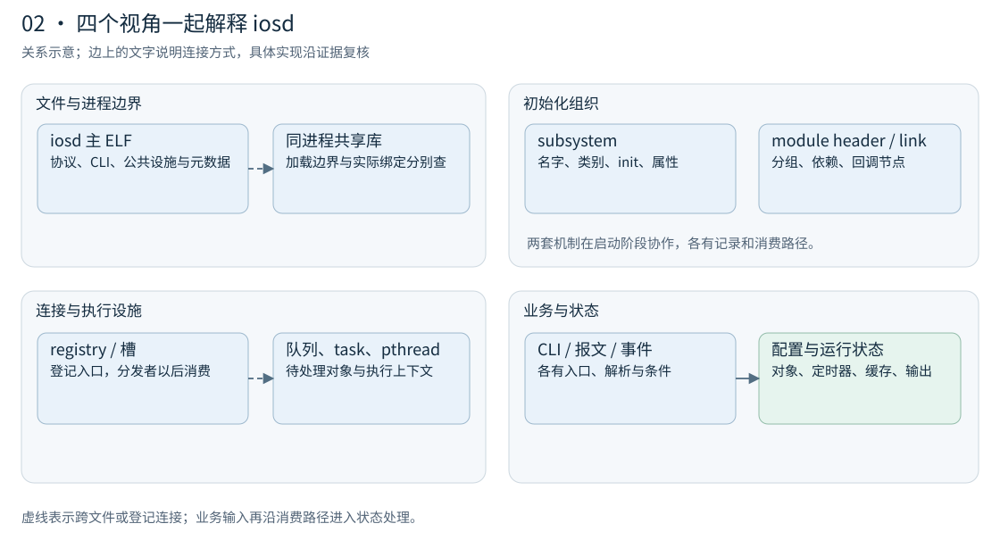

# iosd-analysis

通过 IDA MCP 辅助安全研究人员理解 Cisco IOS XE 的 iosd：从大型 ELF 的组织结构出发，调查 CLI 定义、模式与注册、协议处理链、配置生成、线程和主备机制。

项目包含一个可独立安装的 **skill**、一篇持续维护的 **调试与分析教程**，以及 **C8000v IOS XE 26.01.02 的样本分析结果**。分析记录保留函数与 RVA、条件、来源、未知动作和不完整分支。



## 可以用它调查什么

- **程序架构**：进程与 ELF/共享库边界、启动编排、module、subsystem、registry、IOS task 和 Linux 线程。
- **CLI**：模式入口、关键词与参数、条件、handler/selector、动态链接槽、pending 注册和未绑定语法片段。
- **协议处理**：从初始化与登记回调定位接收分发、队列、报文解析、状态更新及外部边界；已有 CDP、BGP、OSPF、UDP 等局部案例。
- **配置与运行机制**：CLI 修改状态、NVGEN 生成配置文本、接口缓存、EHSA 心跳与主备状态机。
- **证据对照**：saved IDB、已暂停进程内存和 ELF core 分别记录；缺页、限额、间接目标及未求值条件随结果保存。

skill 组织调查流程和经验知识，IDA MCP 提供数据库与调试接口，Python 核心完成离线解析、索引和路径恢复。

## 从哪里开始

| 入口 | 内容 |
|---|---|
| [完整教程与使用说明](如何调试iosd.md) | 虚拟与实体设备调试、MCP、skill 安装使用、源码与文档维护 |
| [iosd-analysis skill](skills/iosd-analysis/SKILL.md) | 给支持 skill 的客户端使用的调查入口 |
| [当前版本分析结果](analysis/c8000v-26.01.02/README.md) | 样本身份、已取得处理链、CLI 数据与覆盖范围 |
| [直接阅读命令文本](analysis/c8000v-26.01.02/commands/README.md) | 按模式拆分的 txt 命令列表，以及参数、handler、条件和缺口参考 |
| [CLI 挖掘方法](docs/iosd的CLI挖掘方法.md) | 动作消费者、语法图、模式、条件与注册分析 |
| [架构图解](docs/iosd架构图解.html) | 下载后可离线打开的八张图解，支持搜索与主题筛选 |

## 安装与使用

```sh
git clone https://github.com/2512500960/iosd.git
cd iosd
```

将整个 `skills/iosd-analysis` 文件夹复制到客户端支持的 skills 目录，保持内部目录结构。按客户端配置连接实际运行的 IDA MCP 服务，然后提出具体问题，例如：

> 使用 $iosd-analysis，解释当前 iosd 的 subsystem、module 和 registry 怎样组织业务代码，并说明这些关系的证据。

> 使用 $iosd-analysis，追踪某个协议的接收、字段解析、队列消费和状态更新，列出主 ELF 与外部组件的边界。

> 使用 $iosd-analysis，调查 config 子模式中的命令定义、条件和 handler，保留待注册、未知和不完整的分支。

也可以在仓库根目录直接运行随附入口，使用 Python 3.10+：

```text
python tools/iosd_mcp.py --url <mcp-url> discover --output reports/session/capabilities.json
python tools/iosd_mcp.py --url <mcp-url> status --output reports/session/session.json
```

`<mcp-url>` 替换为当前 IDA 实例的实际地址。Python 入口使用 MCP 的 `py_eval`；其他类型化接口由 skill 按实际能力适配。详细示例见 [MCP 会话说明](skills/iosd-analysis/references/mcp-and-session.md)。

已有样本数据可在 GitHub 直接阅读：[命令文本总索引](analysis/c8000v-26.01.02/commands/README.md) 将 98,812 条路径见证按 287 个模式主名称编排，每页提供简明 `.txt` 与详细 `.md`。基础连接、补充模式和条件安装分别列出；另外保留 1,350 个尚缺完整路径的候选。

也可在本地通过命令行查询：

```text
python tools/query_cli_catalogue.py analysis/c8000v-26.01.02/cli/catalogue.jsonl.gz --mode configure --contains "service internal" --limit 10 --json
```

## 当前分析范围

已实测环境为 IDA 9.1、ELF64 x86-64，以及 MD5 为 `9eccfd46caadfff9c18557e2a446e19b` 的 C8000v 26.01.02 iosd。其他版本可复用调查方法，地址、布局和语义由对应消费者重新核对。

基础六模式图中记录 23,145 个终止定义候选、13,690 个已有路径覆盖的不同 EOL，以及 73,159 条代表路径。

原未关联的 9,455 个候选已经逐项分类：3,057 个连接到新增 config 模式入口；3,556 个依赖已捕获槽位上的候选注册；1,479 个还依赖静态槽位创建调用；13 个关联到其他模式入口。新增路径覆盖这 8,105 个终止候选，其余 1,350 个继续保留未知关系。

新增模式与条件路径见 [未关联候选分析](docs/iosd未关联命令与配置子模式.md) 和 [版本结果](analysis/c8000v-26.01.02/README.md)。定义、终止节点、代表路径和实际可执行命令分别记录，整体命令总量按覆盖范围解释。

运行时读取使用已暂停目标及验证后的映射与锚点；core 入口当前支持未压缩 ELF64 x86-64。MCP 请求按实例串行执行，超时后保留 pending 记录，确认 IDA 空闲后恢复。

## 仓库结构与开发

- `skills/iosd-analysis/`：可复制安装的 skill，附参考资料、分析核心和工具副本。
- `iosd_helper/`：维护中的解析核心；`tools/`：采集、分析、导出和校验入口。
- `profiles/`：带样本身份约束的布局与消费者语义。
- `docs/`：架构与机制说明；`analysis/`：特定版本的派生分析结果。
- `如何调试iosd.md`：完整教程与操作说明的主文件。

```text
python -m unittest discover -s tests -q
python -X utf8 tools/build_skill_release.py
python -X utf8 tools/check_skill_release.py
python -X utf8 tools/check_tutorial_assets.py --git-ref HEAD --bundle
```

主 MCP 入口和核心使用 Python 标准库。部分文档生成工具使用 `requirements-docs.txt` 中的依赖。构建后可从 `dist/` 取得 skill 压缩包；生成来源和 SHA256 保存在 `build-manifest.json`。

仓库分发代码、文档、profile 和派生元数据；分析使用的 Cisco 固件、IDB、core 与原始内存捕获由研究者在本地准备。
