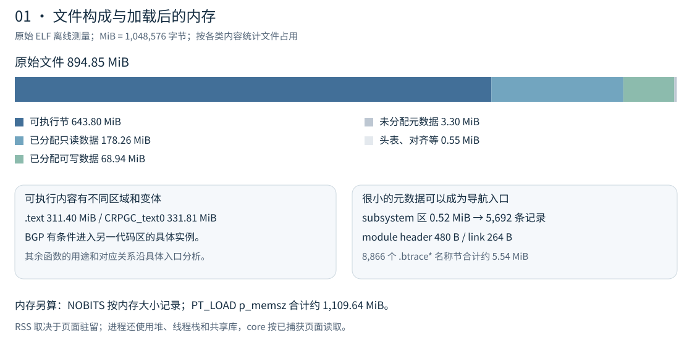
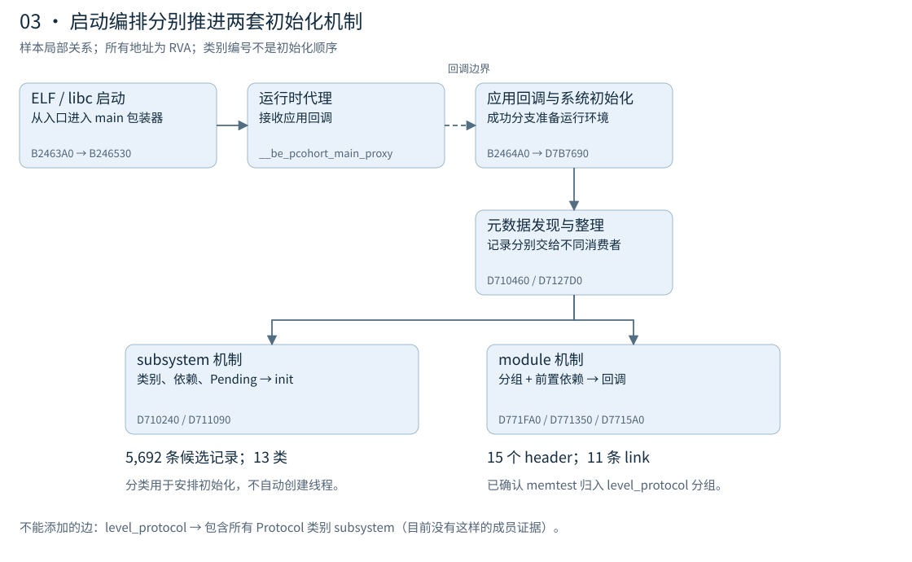
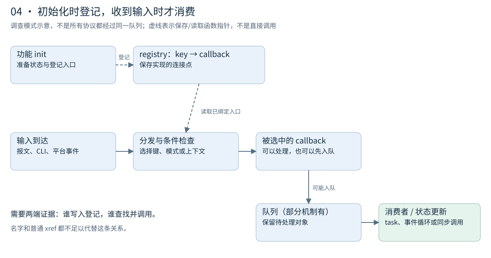
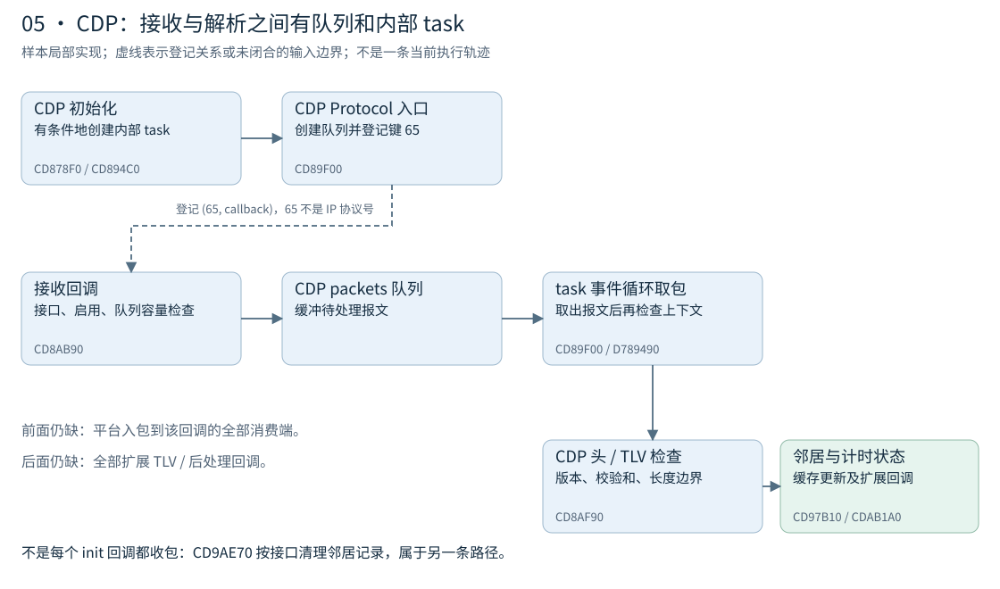
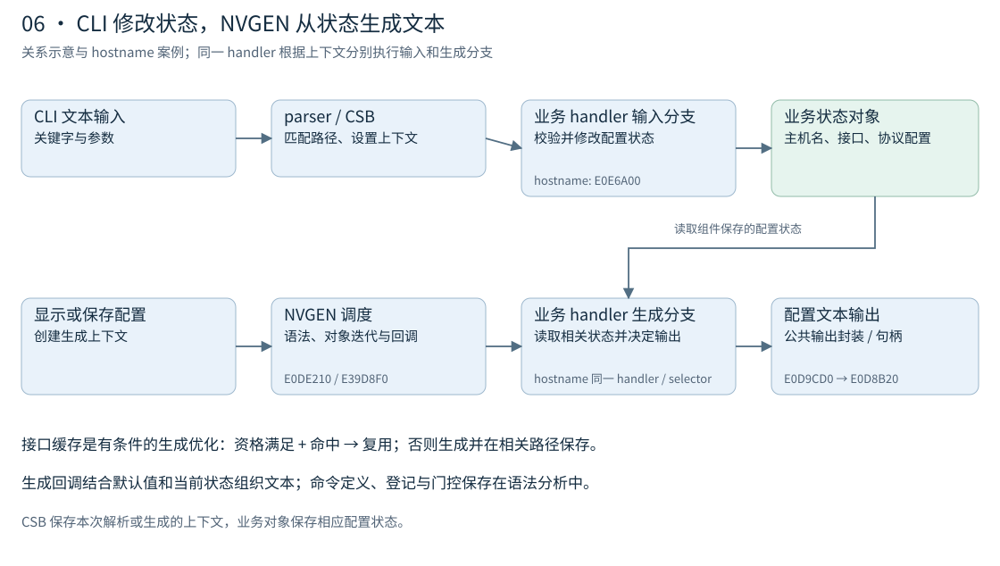
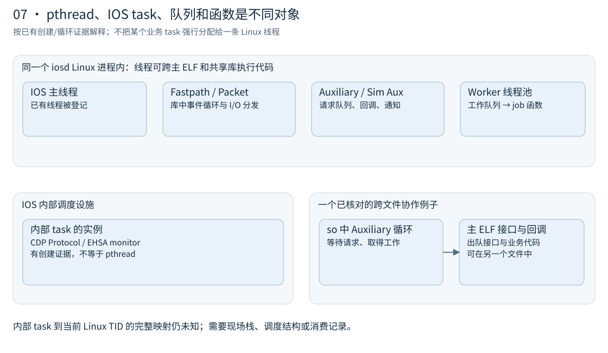
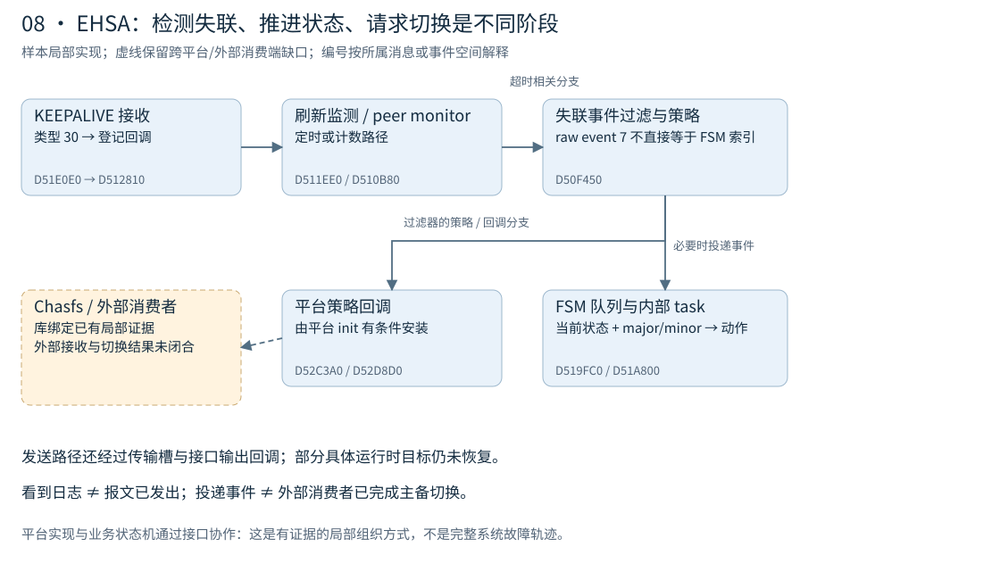

# 看懂 iosd：从大 ELF 到运行机制

这份说明从研究人员打开一个几百 MiB 的文件时最容易遇到的问题开始：这么多函数，应该先看哪里？这里先给出组织关系，再用真实处理链说明代码怎样工作。阅读时不用先记住地址；地址是方便回到 IDA 核对的路标。

适用对象为 C8000v IOS XE 26.01.02，MD5 `9eccfd46caadfff9c18557e2a446e19b`。图分为两类：**关系示意**解释概念，**样本局部实现**只画已有证据支持的连接。实线和虚线的含义写在每张图里，虚线可能表示回调登记或尚未追完的边界，不能一律理解为函数调用。

## 1 文件到底大在哪里

本轮在不访问 IDA 的情况下重新读取原始 ELF 头、program headers 和 section headers，并对整个文件校验 MD5、SHA256。文件长度为 **938,319,552 字节，约 894.85 MiB**。图按 ELF 标志分类，使用的是文件字节数，不是反编译后的行数，也不是协议的数量。

| 文件部分 | 大小 | 阅读时应该想到什么 |
|---|---:|---|
| 带执行标志的节 | 643.80 MiB，约 71.9% | 机器码及跳板等可执行内容；不等于全部互不重复的业务功能 |
| 已分配的只读数据节 | 178.26 MiB，约 19.9% | 常量、重定位、展开信息等多种内容；不只是 CLI 字符串 |
| 已分配的可写数据节 | 68.94 MiB，约 7.7% | 初始化数据、指针槽、元数据等；不是一张完整配置数据库 |
| 未分配元数据及其他文件空间 | 约 3.85 MiB | 字符串、节头、对齐等；其中未分配节不随 PT_LOAD 按业务数据装入 |

两个很大的可执行节分别是 `.text`（约 311.40 MiB）和 `CRPGC_text0`（约 331.81 MiB）。本轮复用的 BGP 函数证据中，普通消息处理函数 `EFCCF10` 有 simulation 条件分支，转入 `22AD4E30`；后者位于 `CRPGC_text0`。这是**存在不同执行变体的一个具体实例**，不能据此断言整个节都是同一种用途、所有函数都一一重复，或设备正在走 simulation 分支。

只读部分也值得拆开：`.rela.dyn` 约 76.10 MiB，`.eh_frame` 约 45.25 MiB，`.rodata` 约 42.15 MiB。节名和标准布局给出查找方向；不能把这一百多 MiB 全算成协议数据或隐藏命令定义。

文件共 8,906 个节，其中 **8,866 个名字以 `.btrace` 开头**，这些节总共约 5.54 MiB。因此“节很多”在这个样本中很大程度上是细分元数据造成的，不能解释成有八千多个独立业务模块。

还要分清文件和内存：`.bss` 声明约 211.22 MiB，`CRFT_func` 声明约 7.42 MiB，二者都是 NOBITS，没有对应大小的文件载荷。3 个 PT_LOAD 的 `p_memsz` 合计约 1,109.64 MiB，包含运行时零初始化区域；这不等于常驻内存 RSS，也不包含后来分配的所有堆、线程栈和外部共享库。可执行文件加载时的零初始化规则，与 core 中未捕获页保持缺失，是两件事。

新测量还有一个很实用的对比：subsystem 描述符区只有 **546,432 字节**，module header 为 **480 字节**，module link 为 **264 字节**。不到 0.6 MiB 的导航元数据就能提供大量初始化入口。先读懂这些入口，比按地址顺序逐个看几百 MiB 的机器码有效。

布局摘要与适用范围见 [原始 ELF 布局](../profiles/elf_layout_26_01_02.json)。这些数值只描述这个文件；没有将段或节的大小转换成组件代码量。

## 2 不用一棵目录树解释整个程序

可以把 iosd 同时看作四张相互连接的图。

**文件与进程图**回答代码放在哪里。主 ELF、`.so` 是装载容器，进程是运行地址空间。Linux 线程可以执行同一进程里不同文件中的代码。主 ELF 调用库函数、库里的事件循环回调主 ELF，都不需要创建另一个进程。

**初始化图**回答功能怎样准备好。subsystem 记录给出名字、类别、init 和属性；module header/link 给出另一套分组、依赖和回调关系。一个 init 可能建立队列，也可能仅登记一个函数指针，并不意味着它创建了一个线程。

**执行与连接图**回答工作怎样发生。registry 保存可供其他代码查找的功能入口；队列保存尚待处理的工作或报文；task、线程和事件循环提供执行上下文。登记函数和实际调用函数的代码可能相距很远，普通直接调用图不一定把它们连起来。

**业务与状态图**回答用户真正关心的行为。命令改变配置状态，报文改变协议运行状态，定时器和平台消息也会改变状态；NVGEN 从相关状态生成配置文本。共享对象、锁、回调和上下文决定这些路径怎样交会。

一个函数可同时拥有几个不同的描述：“机器码在 iosd 主 ELF”“作为 CDP 的回调登记”“由某个队列消费者调用”。这几个描述分别有用，不能强迫它只能属于一个模块。安全研究中最重要的是保留**输入、条件、消费者和状态**，而不只是给函数贴协议标签。

## 3 启动时怎样把功能准备好

当前样本的 ELF 入口是 `B2463A0`。它通过 libc 启动设施进入 main 包装器 `B246530`，再将应用回调交给运行时代理。应用回调 `B2464A0` 的相应成功分支进入系统初始化 `D7B7690`。图中的代理边界是回调传递，尚未证明代理内部每一步怎样调度，不能把它画成全部直接调用。

在已审查的系统初始化路径中，先准备执行环境，然后准备 module 发现容器、发现记录、整理初始化关系，再推进相关类别和分组。这个顺序解释了“线程先存在，后面的功能再把工作接入”的一种实际组织方式。

subsystem 描述符的已保存目录中有 5,692 条记录，分为 13 个类别，包括 Kernel、Library、Driver、Protocol、Management、Registry、SystemInit、EHSA 等。类别是初始化编排使用的属性，编号不是执行顺序；Kernel 类别也不是 Linux 内核本体。Protocol 类别有 2,016 条候选记录，Registry 有 1,731 条，它们的数量既不等于协议种类，也不等于 Linux 线程数量。

module 机制另有 15 条 header：14 个 `level_*` 分组和带回调的 `memtest`。11 条已保存 link 中，10 条是前置依赖，1 条把 `memtest` 归入 `level_protocol` 分组。这里可以确认这个 **module 内部**的成员关系；没有同样的证据把所有 Protocol 类别的 subsystem 塞进该分组。

`E0E33E0` 的相关路径既推进 Protocol 类别，又推进 `level_protocol` 分组，说明两套机制在启动中协作。它们分别解决发现、分类、依赖和回调执行，不能用一个含糊的“模块树”替代。

深入的消费者、布局及依赖例子见 [模块与子系统](iosd模块与子系统.md)；ELF 入口、代理与应用回调见 [启动与术语](iosd架构与术语说明.md)。这些初始化关系是静态代码和保存记录证据，不是本轮重新观察的完整启动轨迹。

## 4 为什么只看调用图经常找不到后半段

图展示一种**调查模式**，不要求所有协议都经过相同的队列和任务。

初始化时，代码把 callback 放进 registry 的某个键或槽。运行时，分发者依据输入种类查这个键，再调用当时绑定的 callback。它可能马上处理输入，也可能把输入入队，让另一个消费者稍后处理。想证明“报文到达了这里”，需要把写入端和消费端接起来。

因此，从 init 出发要同时看直接调用和“把代码地址作为参数传进去”的地方。从字段解析函数反向追，则要检查谁提供缓冲区、长度、接口或邻居上下文，以及经过了哪些拒绝条件。普通 xref 没有连起来也不代表实现不存在：tagged 大端指针、动态槽和未分析代码都可能造成缺边。

这里还存在几个不同的状态，不能混成“命令已找到”或“协议已启用”：

| 状态 | 能说明什么 | 还不能说明什么 |
|---|---|---|
| 静态定义存在 | 文件/IDB 中有描述符或实现候选 | 当前已经登记 |
| 当前登记存在 | 某次暂停快照里槽或链表指向它 | 当前配置和上下文允许进入 |
| 条件放行 | 已核对的特定门控满足 | 所有其他门控也满足 |
| 实际执行 | 有对应运行轨迹或执行证据 | 其他状态、平台、路径也这样执行 |

CLI 的晚注册、帮助隐藏和解析拒绝要分别调查；同样，协议登记的回调也可能是清理、接口变化或认证查询，不能全部命名为收包解析器。

## 5 用 CDP 把抽象关系接到真实代码

CDP 的已复核初始化入口 `CD878F0` 通过相关路径使 `CD894C0` 创建名为 `CDP Protocol` 的 IOS 内部 task，入口为 `CD89F00`。task 入口创建 `CDP packets` 队列，并登记键 65、回调 `CD8AB90`。**65 是这套登记接口中的键，不能解释成 IP 协议号。**

`CD8AB90` 检查接口及启用状态、队列容量。相应成功分支把报文交给队列，拒绝分支另有释放或通用处理。`CD89F00` 的事件循环从同一队列取包，继续检查上下文，再调用 `CD8AF90`。

`CD8AF90` 检查最小头长、版本、校验和以及 TLV 边界，查找或分配邻居记录，进入缓存更新路径并设置 TTL 相关计时。部分扩展项和后处理还通过 registry 回调处理，尚未全部枚举。

这条链带来两个具体结论：第一，已审查的头/TLV 与邻居处理实现在主 ELF 内；第二，入队成功和完成协议解析是两个阶段。设备报文入口如何经平台设施进入这套回调，以及所有外部边界，仍需补齐。

对比 BGP 和 OSPF 可以看出，不应该把 CDP 结构写成所有协议的模板：BGP 已找到消息分发和会话状态门控，但 TCP 字节流到消息的组装仍有缺口；OSPF 已找到队列消费者与 LS Update 分支，但认证、区域选择到队列的前半段还未闭合。UDP 的 socket 查找与投递又是另一种连接方式。

本轮恢复 MCP 后，还补了三段具体证据。OSPF 的 `FC2A190` 在普通参数路径根据 IP 头长度计算后续头位置，读取 `+1` 字节，并把不在已检查范围的类型转为 0；它的调用者 `FBE9060` 才按返回值将类型 4 交给 `FC05800`。因此“取类型”和“处理 LS Update”是相邻但不同的职责。

BGP 的 `F20A5E0` 已核对大小失败、缓冲准备、属性处理调用、NLRI 长度核算及后续分支。属性处理目标 `F1F8D10` 有 57,547 字节，超过本批 16,384 字节的反编译上限；该调用及失败分支有证据，目标内部的全部属性处理仍未恢复。不能因为入口已找到就说 UPDATE 已完全解析。

UDP 又提供了一个容易误读的例子：`CE451D0` 的一条分支调用 `CE44F10`，但继续读后者可见，它仍会检查广播资格、入队，并可能通过 registry 通知下游。**直接调用了一个函数，不等于已同步调用应用层载荷解析器。** 应沿队列和通知的消费端继续找真正的业务处理。

完整的局部证据及 LLDP、IS-IS 等未完成入口见 [协议处理链](iosd协议处理链与CLI新会话验证.md) 和 [定位索引](../profiles/protocol_paths_26_01_02.json)。

## 6 配置是一条输入路径，也有一条生成路径

输入 `hostname ...` 时，parser 沿语法图匹配关键字和参数，准备 parser context（CSB），再调用 handler 修改状态。以后显示 running-config 时，NVGEN 使用生成上下文及配置语法/对象迭代路径，让相应回调读取状态并输出文本。

在已核对的 hostname 案例中，CLI EOL 与 NVGEN 节点都指向 handler `E0E6A00`，selector 均为 0；handler 根据 NVGEN 标志走不同分支。接口 description 也有共享回调的实例，接口对象中保存描述状态。**一个函数被 CLI 和 NVGEN 共用，不代表两条路径做同一件事。**

生成引擎 `E0DE210` 负责上下文和调度；`nvgens_action` 的消费者 `E39D8F0` 把生成调用接到业务回调；公共输出封装经 `E0D9CD0 → E0D8B20 → E0E1B20` 汇总文本。框架可以不理解每个协议的具体配置字段，组件回调负责解释自己的状态。

接口配置文本缓存是生成路径的一个优化：符合资格且命中缓存时复用文本，否则生成并在相关路径保存。已经定位开关、资格、命中、保存和部分清理路径；当前是否启用、哪些接口有缓存、所有失效触发器并未全部验证。缓存图中的条件不能省掉。

所以，`show running-config` 输出不是所有 CLI 定义的清单；ICM 文本树也不是全部 parser 语法。配置状态、命令定义、当前登记、生成文本要分别表示。详见 [NVGEN 与接口缓存](iosd的NVGEN与接口配置缓存.md)。

## 7 线程、内部 task、队列和函数各是什么

Linux pthread 是操作系统调度的执行实体。IOS 内部 task 则是 iosd 内部调度设施管理的工作上下文。队列保存待处理对象，函数是被调用的代码入口。一个 task 不自动对应一个 pthread，一个 subsystem 也不自动对应任意一种任务。

此前现场的线程调查核对了 IOS 主线程、Fastpath、Packet、Auxiliary、Sim Aux 和两个 worker。主 ELF 调用执行环境准备设施；部分 pthread 的创建和事件循环实际在 `libiosd_crb_vxe_unix.so` 内，worker 的实际绑定在 `libthpool.so`。这些是特定现场核对的绑定，不保证在所有平台或新会话中保持相同。

Auxiliary 是一个有用的跨文件例子：库中的循环等待请求，调用主 ELF 的出队接口取得函数指针，再执行请求。**循环在 so，队列接口和业务回调可以在主 ELF**。不能看到线程入口在 so 就说整个功能都由 so 实现，也不能看到一个 PLT 跳板在主 ELF 就把最终实现归到主 ELF。

CDP Protocol、EHSA peer monitor、REDUNDANCY FSM 等名字出现在内部 task 的创建证据中；没有证据把它们一一分配给 IDA 列出的 Linux 线程。实际归属需要现场栈、调度器映射或请求消费证据。

`level` 也要随消费者解释：module 的 `level_protocol` 是分组名字；thread_level 相关代码建立栈/执行上下文；CLI privilege 是另一套访问属性。它们不能因为都带 level 就共用一张数字解释表。细节见 [线程、任务与 level](iosd的线程与level.md)。

## 8 EHSA 展示协议之外的状态驱动协作

EHSA 的局部实现把“发现对端失联”和“完成主备切换”分成多个阶段。类型 30 的 KEEPALIVE 接收经过 `D51E0E0` 分派到登记回调 `D512810`，相应路径刷新监测。peer monitor `D510B80` 负责周期活动及超时相关分支。

失联产生的 raw event 7 经过 `D50F450` 的过滤和平台策略，必要时提交 FSM 事件队列。FSM task `D519FC0` 再经 `D51A800` 使用通用表驱动引擎推进状态。raw event 7、网络消息类型 30 和 FSM 的 major/minor 属于不同编号空间。

平台 init `D52C3A0` 在能力条件成立时安装有关回调；其中 `D52D8D0` 的相关路径访问 Chasfs，发布 `notification/stby-request-swo` 属性。此前对部分实际绑定的核对指向 `libchasfs.so`，但属性发布后的外部消费者和完整切换结果仍没有闭合。

这解释了为什么“看到心跳日志”“发生超时”“投递 FSM 事件”“请求切换”“完成切换”不能互相替代。它也提供一种通用研究方向：把输入、事件、状态表、平台策略和外部消费端分别定位。详见 [EHSA 实现](iosd的EHSA心跳与主备状态机.md)。

## 9 以后分析一个新功能，应交付什么

为了让分析结果能读懂，每个功能都应回答几个连续的问题：**它做什么，谁初始化它，输入从哪里来，在什么上下文处理，读取或修改什么状态，怎样输出或跨出当前文件，哪里仍未知。** 先用行为讲清楚，再附函数、RVA、槽位和原始证据入口。

例如调查一个尚未深入的协议，可以先从保存的组件目录选择相关 init，再从登记参数、字符串引用、错误路径和调用者两边追踪。输出应是带边界的功能卡及局部处理图，不只是搜索命中列表，也不应凭想象补出一条漂亮但未经验证的全链。

这版图解已经能解释容器、初始化、执行设施及多类业务的连接方式，仍不是完整恢复的源代码架构。尚缺的主要部分包括：全部函数的功能归属、所有协议的端到端流程、完整 CLI 语法与激活条件、全部共享库绑定和 IPC 接收方，以及跨运行阶段的实际调度轨迹。

本轮先取得**原始文件的布局与大小证据，并整理既有材料**。随后用户明确确认 IDA 已恢复空闲，才归档旧 pending、重新核对身份并恢复短批次 IDB 读取。目标当时在运行，没有自动暂停，也没有读取运行中的目标内存。图中的历史运行状态不作为当前现场值使用，自动任务保持删除。

子系统扫描预算修复和协议摘要附带逻辑都已完成本轮实机复测。扫描返回 683 条记录、0 个记录读取错误，同时明确 `partial=true`，不能当成全部目录；含工具与模块准备的整次采集约 11.7 秒。完整 5,692 条的数字仍来自之前身份匹配的保存目录。

## 10 图和证据怎样复核

| 图 | 证据来源与范围 |
|---|---|
| 文件构成 | 本轮离线解析原始 ELF；[布局摘要](../profiles/elf_layout_26_01_02.json)，不解析全部机器码 |
| 四张关系图、登记模式 | 概念示意；从下列局部实现归纳，不是全局所有权或直接调用证明 |
| 启动与两套机制 | [启动与术语](iosd架构与术语说明.md)、[模块与子系统](iosd模块与子系统.md)、[带样本约束的架构 profile](../profiles/architecture_26_01_02.json) |
| CDP 与其他协议 | [新会话局部复核](iosd协议处理链与CLI新会话验证.md)、[协议定位摘要](../profiles/protocol_paths_26_01_02.json) |
| CLI / NVGEN | [NVGEN 及接口缓存](iosd的NVGEN与接口配置缓存.md)，含 handler、descriptor、context 与消费函数 |
| 执行上下文 | [线程与 level](iosd的线程与level.md)，特定现场的创建、循环和绑定证据 |
| EHSA | [心跳与主备状态机](iosd的EHSA心跳与主备状态机.md)，保留传输、平台条件及外部未知项 |

原始 IDB、ELF、core、内存转储和完整反编译不随 skill 分发。复制 skill 后可以阅读全部图解；重新确认某条实现关系时，仍需要身份匹配的 IDB/内存或本地保存证据。
