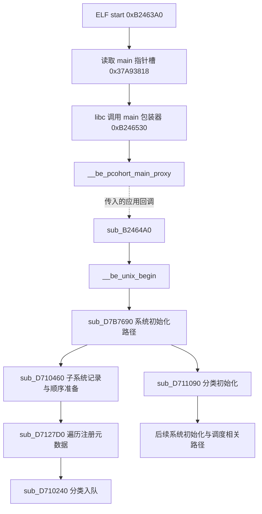

# iosd 架构 启动流程与术语说明

> 历史分析资料：保留样本、条件和未知项。原始捕获及 GUI 实验不随 skill 分发；历史材料路径用于定位已有证据，不表示文件已包含。


连续阅读请从 iosd 程序架构与分析指南（历史材料路径：`iosd逆向分析教程.html`） 开始。本文件保留较详细的架构观察和证据链接。

iosd 是 IOS XE 中承载大量控制面功能的用户态程序。理解它需要同时观察进程边界、启动阶段、初始化分类、子系统记录、命令注册图、消息接口和数据模型；这些概念不构成一棵简单的“进程包含模块，模块包含函数”的目录树。

**当前可以浏览一部分顶层结构，尚不能宣称已恢复整个 iosd 架构。** 本说明针对 C8000v 26.01.02 样本，输入 MD5 为 `9eccfd46caadfff9c18557e2a446e19b`，IDA 9.1，imagebase 为 0。地址仅用于定位这份样本；规则或名称是否能跨构建复用，需要分别验证。

文中的“已验证”指直接字节、符号、交叉引用或反编译支持该关系；“候选”指有具体证据、但语义尚未完全确认；“待确认”表示不能作为插件自动判断的依据。相关原始输出保存在项目的 `reports/`，这些私有分析文件默认不加入版本控制。

## 一 不同层次的概念

| 概念 | 在研究中代表什么 | 当前能看到什么 | 不宜作出的推断 |
|---|---|---|---|
| IOS XE 系统 | Linux 与多个服务进程组成的平台 | 外部架构资料及 iosd 的导入和通信线索 | 一个 iosd IDB 包含全系统代码 |
| iosd 进程 | Linux 用户态进程 | 程序入口、函数、静态数据；有快照时可见堆对象 | 一个 subsystem 对应一个 Linux 进程 |
| 初始化阶段 | 启动代码按条件推进的工作 | 实际 main 包装器、运行时代理、系统初始化、分类初始化 | 编号顺序就是全部真实执行顺序 |
| 子系统分类 | 初始化和组织子系统的类别 | Kernel、Protocol 等 13 个类别名与编号 | 13 个类别就是 13 个业务模块 |
| subsystem | 带名称、入口和属性的注册实体 | 5,692 条候选记录，5,678 个不同名称 | 每条记录拥有连续且互斥的代码区间 |
| module header 与 link | 当前样本中的另一套注册元数据 | 14 个 `level_*` 分组、`memtest` 和 11 条 link；已核对分组与依赖消费者 | 这套 module 图就是 subsystem 的父子层级 |
| component 与源码路径 | 源码组织留下的文字线索 | 3,542 条路径，涉及 37 个 component 名称 | 每条路径等于一个可完整恢复的编译单元 |
| 注册表与回调槽 | 数据中的指针及其安装和消费位置 | 部分注册入口、函数指针和静态表 | 存在函数指针就意味着 CLI handler |
| 消息接口 | 消息处理、分派和进程通信入口 | 名称分类及部分调用关系 | 所有内部交互都只经消息发生 |
| 数据模型 | 配置与状态访问接口 | `tbl_*` 等函数名和调用线索 | 所有 `tbl_*` 都已证明来自某份 YANG |
| CLI 静态图 | 关键词、参数、分支及动态链接点的定义结构 | 注册入口清单、局部语法图和部分 EOL handler | 当前图覆盖全量命令或所有运行模式 |
| ICM 配置树 | 配置文本的层次、输出及差异操作结构 | 72 字节节点的部分字段和遍历逻辑 | 这棵树就是主 CLI 分派语法图 |
| Linux 线程与 IOS 调度抽象 | 不同层次的执行单位 | 部分 pthread、调度器、虚拟进程线索 | 同名进程/任务一定有对应的 Linux PID/TID |

控制面与数据面也属于不同层次。在 ASR 等架构中，Cisco 描述的配置更新路径包含 IOSd、FMAN-RP、FMAN-FP 和 QFP；这不能直接推广成所有 IOS XE 平台都使用相同硬件和进程布局。[Cisco CEF 架构说明](https://www.cisco.com/c/en/us/support/docs/ip/express-forwarding-cef/211377-Understand-and-Troubleshoot-CEF-on-IOS-X.pdf)

## 模块与子系统的实际关系

当前已经从 module 消费代码确认：header 可生成分组或带初始化回调的节点；两种 link 分别表达前置依赖和分组关系。`memtest` module 节点属于 `level_protocol` module 分组，而 `level_protocol` 对 `level_driver` 有前置依赖。这里的 module 是初始化图对象，不是共享库文件，也不是 subsystem 的统一父级。

subsystem 使用另外的 96 字节记录、类别与属性依赖。启动代码会分别推进两套初始化；同一次发现同时处理这些记录，不代表合并成同一种对象。详细字段、消费链、设计解释与协议代码归属方法见 [iosd 模块 子系统与初始化架构](iosd模块与子系统.md)。

## 配置状态与 NVGEN 的职责划分

当前样本的配置生成入口 `sub_E0DE210` 创建专用 NVGEN CSB，设置模式和输出目标，普通路径沿模式语法起点与对象迭代调用生成回调，并在前后执行 registry 钩子。这条路径不通过逐个调用 subsystem init 来取得配置。业务 handler 读取自己负责的状态，公共输出设施汇总成文本；`hostname` 和接口 `description` 已确认 CLI EOL 与 NVGEN 描述符共用函数及 selector。

样本还实现 `parser config cache interface`：资格检查通过时复用接口对象中保存的文本，未使用缓存时生成并保存相应片段；禁用路径可遍历接口释放缓存。当前启用状态以及所有配置更新的失效触发点尚未完整验证。入口、字段、回调实例和原始证据见 [iosd 的 NVGEN 与接口配置缓存](iosd的NVGEN与接口配置缓存.md)。

## EHSA 的运行时职责

Linux 线程、IOS 内部任务和 module/subsystem 的关系另见 [iosd 的线程 任务与 level](iosd的线程与level.md)。当前已核对七条 Linux 线程及外部库创建路径；module 的 `level_*` 与线程栈初始化的数字 level 属于不同机制。

当前样本中，peer monitor 通过定时器和计数器检测对端活性；bootstrap 接收分派按类型将 KEEPALIVE、BOOT 和 ACK 等消息送入对应回调；FSM 任务消费 major/minor 事件，按状态表进入动作；平台子系统再提供故障和切换策略。心跳检测、状态推进和最终切换需要分别理解。

已取得的 EHSA 表有 14 个状态、224 个事件槽及 19 个不同动作回调，全部保留，包括状态 7 的未知名称、null 动作和未闭合的事件来源。核心实现位于主 ELF；本次 GOT 绑定核对确认部分接口位于 `libchasfs.so`、`libcyan.so` 和 `libiosd_crb_vxe_unix.so`。Chasfs 属性 `notification/stby-request-swo` 的外部消费链尚未闭合。具体函数、子系统、module 阶段依赖及采样边界见 [iosd 的 EHSA 心跳与主备状态机](iosd的EHSA心跳与主备状态机.md)。

## 二 已核对的启动路径



虚线表示调用者将回调传给导入的运行时代理；代理内部的全部调度行为不在这次直接调用链的证明范围内。

### ELF 入口与真正的 main 包装器

`0xB2463A0` 是 ELF 启动入口。它准备 `argc/argv` 等参数，从 `0x37A93818` 这个名为 `main` 的指针槽取出 `0xB246530`，传给 `__libc_start_main`。因此 **`0xD710460` 不是 ELF main**。

`0xB246530` 调用 `__be_pcohort_main_proxy`，将 `sub_B2464A0` 作为应用回调传入。后者执行前置检查；`__be_unix_begin` 成功后调用 `sub_D7B7690(0, 0)`，之后还有 `__be_unix_end` 路径。

证据：入口与名称查询（历史材料路径：`../reports/mcp-start-and-parser-names.json`）、main 指针槽（历史材料路径：`../reports/mcp-main-resolve.json`）、main 包装器（历史材料路径：`../reports/mcp-actual-main.json`）、应用回调（历史材料路径：`../reports/mcp-proxy-callback.json`）。

### 系统初始化与子系统准备

`sub_D7B7690` 包含硬件/软件匹配检查、运行环境准备、初始化和调度相关设施检查。在相应条件满足时，依次调用 `sub_D771E60`、`sub_D710460`、`sub_D772050`、`sub_D711090(7)`，随后继续其他系统初始化工作。

`sub_D710460` 的主要职责是准备子系统分类和顺序，创建 `Subsys Pending`、`Subsys Init Malloc List`、`Subsys Init Loadtime List` 等容器，并调用 `sub_D7127D0(sub_D710240)` 收集注册实体。

`sub_D7127D0` 遍历当前映像的子系统记录，步长 96 字节；还存在对共享库相关对象的遍历，以及按 32 字节、24 字节分别处理 header 和 link 的逻辑。

`sub_D710240` 检查记录版本和类别，将记录放入分类容器或 Pending。`sub_D710BC0` 会解析属性中的名字和依赖顺序，并递归处理 Pending 记录。**这里不能解释为“逐个创建子系统线程”。**

`sub_D710460` 尾部的 `sub_D767810` 含有 `Chunk destroy` 诊断并释放容器相关对象，**不是进入常驻调度循环**。该初始化例程会返回其调用者。

证据：系统初始化路径（历史材料路径：`../reports/mcp-start-parent.json`）、子系统准备（历史材料路径：`../reports/mcp-start-main.json`）、分类回调（历史材料路径：`../reports/mcp-start-callback.json`）、元数据遍历（历史材料路径：`../reports/mcp-module-init.json`）、Pending 顺序处理（历史材料路径：`../reports/mcp-subsys-pending.json`）、chunk 清理（历史材料路径：`../reports/mcp-subsys-finalize.json`）。

### 分类初始化

`sub_D711090` 使用分类顺序表遍历对应记录，调用 `sub_D711BA0` 等初始化辅助函数，记录开始/结束和耗时，并处理相关通知回调。它在系统路径中有后续调用；不能把一个 `sub_D711090(7)` 误读为全系统只初始化一个类别。

| 类别编号 | 可见名称 | 阅读时的含义 |
|---|---|---|
| 1 | Kernel | IOS 内部基础设施类别，不是 Linux 内核本体 |
| 2 | Library | 库与公共基础能力类别 |
| 3 | Driver | 驱动相关类别，不等于所有代码都操作硬件 |
| 4 | Protocol | 协议相关类别 |
| 5 | Management | 管理相关类别 |
| 6 | Registry | 注册及回调相关类别 |
| 7 | SystemInit | 系统初始化类别 |
| 8 | EHSA | 高可用相关初始化类别；具体组件职责由 init 和消息消费者核实 |
| 9 | Pre-Driver | 驱动前置类别 |
| 10 | IFS | 文件系统相关类别名称；具体边界需逐条核实 |
| 11 | Microcode | 微码相关类别 |
| 12 | Pre-EHSA | EHSA 前置类别 |
| 13 | License | 许可相关类别 |

编号不是执行顺序。`sub_D710460` 与 `sub_D711090` 都访问另一张顺序映射表。14 个 `level_*` module 记录又是另一套元数据，两者不能只按数量或名字直接一一配对。

证据：分类初始化（历史材料路径：`../reports/mcp-subsys-class-init.json`）。

## 三 CLI 分析需要区分的三套结构

### 静态注册表与 transition 图

flow 子系统初始化函数 `sub_C154250` 和 `sub_C1E5A10` 将静态表传入 `sub_DEF7870`。该函数以 16 字节步长读取两个指针，并以特定哨兵地址结束，再交给 `sub_DEF70B0` 处理。

当前提取器把记录表示为“link key → root”，保留表来源、调用位置、初始化函数线索和条件。它们不是已经确认的 EXEC/config 模式名称。静态数据里的候选 transition 为 40 字节：`+0/+8` 两条候选边，`+16` 大端操作码，`+24` 数据指针或不透明载荷。本样本这些静态指针按小端读取，不能把其他运行时结构的字节序规则直接套过来。

进一步检查 `sub_DEFF7A0` 分派代码，确认它以操作码索引 `0x3409EC00` 的动作表，每项 24 字节：`+0` 静态函数指针，`+8` 名称指针，`+16` 大端编号。314 个槽位均可读出动作名称，186 个有静态回调；186 是 `LAST_INTERNAL_ENUM`，187..313 的回调可由 `sub_DEFF740` 在运行时注册。未填回调不等于命令定义不存在，也不证明必须依赖内存才能继续分析其注册代码。

已核对部分动作的消费代码，并在 0.3.0 中实现以下字段解释：

| 动作 | 静态提取内容 | 保留的边界 |
|---|---|---|
| `keyword_action` / `keyword_id_action` | 关键词、帮助文本、描述符原始字节 | 权限描述符及 ID/state 字段未完整解释 |
| `eolns_action` / `eolns_command_action` / `eols_action` / `eols_command_action` | 载荷 `+0` 的 handler 候选；适用时取 `+8` selector | 处理函数字段可定位；模式、权限和运行时门控未验证 |
| `general_number_action` | 数值范围、存储偏移、帮助文本 | flags 未解释 |
| `general_string_action` | 存储偏移、大小候选、帮助文本 | LINE/WORD 等 flags 未解释 |
| `testexpr_action` | 谓词函数、载荷 `+8` 的 false 目标 | 从不执行谓词；正常解析和 help/NVGEN 调度规则不同 |
| `nvgens_action` | 配置生成回调 | 与命令终结 handler 分开记录 |

EOL flags 的原始字段位置并非统一：`eolns_command_action` 使用载荷 `+8`，其余上述三类使用 `+12`。`eols_mode_action` 有按上下文选择回调的逻辑，暂未按普通 EOL 解码。所有地址规则目前只针对这份样本。

flow 局部图现有 **6 条注册记录、70 个节点、102 条边、25 个关键词节点、14 个 EOL 节点、11 个不同 handler 候选**，以及 3 个参数节点。相比初版，多识别了 `keyword_id_action` 并跟随 `testexpr_action` 的 false 边。`exporter`、`statistics`、`templates` 等文字来自数据描述符，仍不能直接拼成完整且可执行的命令。

3 处图节点落在运行时初始化的区域或已知链接占位位置，图中明确保留断点。注册调用还有模拟环境分支以及 `sub_C126250` 返回值相关条件。当前提取的是这些条件下的静态定义候选集合，不表示条件在设备上都成立。

通用入口发现检查了 `sub_DEF7870` 的 1,720 处直接调用，在调用前有限指令范围内恢复首参数候选，并校验表的指针对、哨兵及根节点。得到 **1,319 个候选表、4,555 条不同注册记录和 4,508 个不同 root**。453 个表的调用者与子系统 init 入口匹配；这只说明注册来源，不划分子系统的全部代码归属。378 处调用的参数没有在此规则下解析，不执行跨函数或间接调用推断。

扩展 profile 按表地址顺序选择前 100 个不同 root，得到 **2,847 个节点、5,001 条边、1,004 个关键词节点、197 个参数节点、299 个 EOL 节点和 126 个不同 handler 候选**。299 个 EOL 节点的候选指针均落在 IDA 函数入口。仍有 4,408 个未选入遍历的 root、932 个未解释载荷节点、3 个链接缺口、2 个未通过简单 token 校验的关键词描述符。动作名称映射不等于载荷语义已全部解释，节点数、EOL 数和注册数也都不等于完整命令数。

0.3.1 新增 `static_cli_all_discovered_26_01_02.json`，不设 root 数量限制，改以 200,000 个节点作保护上限。同一 IDB 已处理 **全部 4,508 个已发现 root**，待遍历节点为 0，没有达到保护上限。得到 **101,521 个节点、169,625 条边、37,718 个关键词节点、9,593 个参数节点、15,049 个 EOL 节点、5,287 个不同 handler 候选**。关键词文本去重为 9,302 种；所有已解码 EOL 候选均对应 IDA 函数入口。

这次扩大的是已知入口覆盖，仍未覆盖所有注册方式或动作语义。报告还有 26,808 个未解释载荷节点、176 个描述符错误、13 个读取/链接缺口、399 个静态回调为空的动作节点，以及前述 378 处未解析注册调用。`reports/static-cli-catalogue.html` 可搜索关键词、参数、EOL、动作编号、注册记录和未解析项；关键词没有被拼接成完整命令。完整语法路径恢复是后续工作。

### 配置模式语法路径（0.4.0）

**覆盖原则补充（0.4.1）**：下面的优先路径只是示例视图。完整分析应保留可能的命令定义，包括未知动作、未绑定模式、未安装的注册片段以及状态尚不满足的分支；不能以语法是否完整或当前能否执行作为排除依据。新的候选定义池独立保留全部已取得节点、结构边和注册，条件不求值，循环与分支保存在图中。它不承诺已发现整个二进制的全部定义。

候选池见 静态候选定义池（历史材料路径：`../reports/iosd-candidate-space-20261029/index.html`）。其中 9,294 个已知 handler 定义尚无模式绑定，3,199 条注册片段缺少核心链接槽匹配，均保留。三层直接调用祖先审计还得到 36 组 handler→注册例程关系候选，未证明实际触发条件或时序；间接调用、状态写入依赖及更深链路仍待分析。原始调用边、条件和状态写入另有 JSONL，不以每组一条展示链代替完整已采集关系。

**VPDN 案例进展（0.4.2）**：已将其中一条线索细化为 `vpdn enable`（selector 28）→资源回调检查→启用状态写入→首次测试注册尝试，恢复其 `test vpn / test vpdn` 片段的 14 个 EOL、19 条已建模无环模板。另经共享 SSS 函数指针找到 6 个 subscriber 跟踪片段，并复核 9 个相关动态槽定义。`no/default vpdn enable` 的已审查分支只清启用状态，不复位注册尝试标志；同一配置 handler 的其他 selector 则因未启用而拒绝。未知链接、未绑定定义和条件继续保留，详见 VPDN 激活链报告（历史材料路径：`../reports/vpdn-activation-20261029/index.html`）。注册返回成功也可能只是进入待绑定队列：后续槽创建会使 parser 入口重试，因此“已提交”“已安装”“业务状态允许执行”是三个不同事实。上述数量属于这个案例的新提取，前一段的候选池统计保留为 0.4.1 基线。

`sub_DFF1CF0` 将明确的模式名称、提示符和根参数传入 `sub_DF3BC00`；其分配例程 `sub_DF3B9B0` 把第 9 个参数保存到 mode `+0x50`。由此确认 `configure/config` 的静态根为 `0x341168F8`，`interface/config-if` 为 `0x34116920`，并得到 exec、subinterface、null-interface、line 的其他定义。模式归属来自注册代码，不根据关键词猜测。

核心链接槽位于 `0x341146E0`，由 `sub_DFF1C10` 按 48 字节返回，`sub_DEF70B0` 使用 key `+0`、root `+16`、大端类型 `+24`，以 key 哨兵 `0x37B04568` 结束。当前 180 个有效槽（178 个 type 1，2 个 type 2）可关联 1,356 条注册记录。路径恢复构造候选连接，保留调用条件，不修改静态节点或重现实际安装顺序；剩余 3,199 条注册记录未匹配核心槽。

本轮新增了独立的语法解释层：关键词 match 分支才消耗关键词，alternate 分支保持原输入；参数亦如此。`test_action` 的比较目标在载荷 `+16/+24/+32/+40`，分别对应 eq/ne/lt/gt。权限、接口状态和全局布尔判断也有描述符内部目标，单独提取。`params_action` / `params_command_action` 含关键词、数字范围、`+24` handler、`+32` selector，可以直接结束命令，不能只搜索 EOL 操作码。

只对已核对的 normal-CLI 调度进行符号处理。sense/default/NVGEN 三个字段的普通输入初始值 `[1,0,0]` 为显式假设；局部常量赋值与比较可求值，外部状态及谓词不求值。不同上下文能得到 `hostname <string>`、`no hostname`、`default hostname`，均指向 `0xE0E6A00`；接口 `description <string>` 指向 `0xE40C850`，`shutdown` / `no shutdown` 指向 `0xE40CF20`。

当前保存 19,056 条 config 示例和 2,357 条 config-if 示例，对应 2,589 个不同 handler。每个终结点与跟踪上下文仅保留一条优先示例，不完整枚举别名、可选分支或循环；所有路径仍受未验证的注册、权限、参数 flags 和运行时条件限制。未知动作以 `<?>` 保留，不能作为已完整恢复的命令。结果见 配置模式语法路径（历史材料路径：`../reports/iosd-config-paths-20261029/index.html`）、模式初始化（历史材料路径：`../reports/path-consumer-mode_init.json`）、mode 分配（历史材料路径：`../reports/path-consumer-mode_allocate.json`）、符号状态字段汇编（历史材料路径：`../reports/path-sense-disasm.json`）。

**没有 dump 也能继续静态提取定义、追踪注册代码和 handler；当前不能宣称提取了所有命令。** dump 或调试能补充某次启动下安装后的链接、动态回调和条件状态，但一份快照也未必覆盖所有许可、硬件、配置及运行模式。静态定义覆盖与某台设备当时可执行的 CLI 集合需要分别验证。

证据：flow 注册入口一（历史材料路径：`../reports/mcp-flow-chain.json`）、入口二（历史材料路径：`../reports/mcp-flow-chain2.json`）、表消费者（历史材料路径：`../reports/mcp-registration-consumer.json`）、链接处理（历史材料路径：`../reports/mcp-register-inner.json`）、动作表（历史材料路径：`../reports/parser-action-registry.json`）、EOL 消费代码（历史材料路径：`../reports/mcp-eols-real.json`）、EOL command 消费代码（历史材料路径：`../reports/mcp-eols-command-real.json`）、EOLNS command 消费代码（历史材料路径：`../reports/mcp-eolns-command.json`）、flow 提取结果（历史材料路径：`../reports/static-cli-flow-semantic.json`）、扩展提取结果（历史材料路径：`../reports/static-cli-discovery-semantic.json`）。

### ICM 配置文本树

`sub_C2F7B50` 和 `sub_C2FA1D0` 中可见 `diff tree`、配置文本缩进、跳过某些行，以及树链维护。它们支持分析配置树，不能替代主 CLI 语法与分派机制的分析。

72 字节节点的 `+0` 用于向下遍历，`+16` 用于回溯，`+24` 用于同级遍历；`+8` 参与树链维护，不能当作 handler。文本通过 `+48` 或根的缓冲区数组读取，受标志、起止偏移及索引控制。这与上面的 40 字节静态 transition 候选不是同一种结构。

进一步检查 `sub_C2F60B0` 与 `sub_C2F6BD0`，可以看到比较两侧配置节点的层级和文本、设置匹配标记，再依据 `is_old` 生成不同方向的差异输出。被标为匹配的节点在相应生成路径中跳过。因此这里涉及配置输入树和差异输出结构，“diff 树”不是该程序支持的全部命令定义集合。

例如以下只是说明结构的配置示例：

```text
旧配置                            新配置
interface GigabitEthernet1        interface GigabitEthernet1
 description old                   description new
 mtu 1500                          mtu 1500
```

树节点保存完整的配置行，如 `description old`，父节点保存它所属的 `interface GigabitEthernet1` 上下文。比较时可以识别 `mtu 1500` 相同、description 两行不同；输出变化时还需要保留接口上下文。具体如何生成 `no` 命令、保留顺序以及执行差异，仍需检查对应消费路径，不由这份示例断言。

证据：配置节点比较与标记（历史材料路径：`../reports/mcp-diff-create.json`）、按 old/new 方向生成差异（历史材料路径：`../reports/mcp-diff-generate.json`）。

### 命令调用包装器与语言绑定

一个函数包含命令文本或 parser 日志，不代表它是注册函数。`sub_F3B6FF0` 包含 KRON CLI 上下文及重定向处理，是命令调用路径的一部分；`sub_19601E40` 包含 FRR manager 初始化及“Unable to parser_add_command”日志，不能因该字符串把整个函数命名为通用命令注册函数。

`parser_add_commands` 字符串关联的 `sub_EA5BCA0` 使用 `lua_gettop`、`lua_touserdata` 等 API，是 Lua 绑定层的候选入口。它与静态注册表消费者 `sub_DEF7870` 需要分别分析。

证据：KRON 包装路径（历史材料路径：`../reports/mcp-parse-dispatch.json`）、FRR manager 初始化（历史材料路径：`../reports/mcp-parser-register.json`）、Lua 绑定（历史材料路径：`../reports/mcp-parser-add-commands.json`）。

## 四 常见概念与缩写

### 文件 地址和执行

| 术语 | 含义 | 研究时要区分 |
|---|---|---|
| ELF | Executable and Linkable Format，可执行与链接文件格式 | 文件中的 section、program segment 与 IDA segment 不一定一一对应 |
| IDB 与 i64 | IDA 分析数据库；i64 是常见的 64 位数据库文件扩展名 | 包含分析结果，不等于原始可执行文件 |
| PIE | Position Independent Executable，位置无关可执行文件 | 静态 RVA 不因一次 ASLR 改变；跨构建 RVA 仍可能变化 |
| RVA | 相对映像基址的地址 | 文件偏移、IDA EA 和运行时 VA 是三种不同地址 |
| ASLR | 地址空间布局随机化 | 运行时基址必须按当前进程核实 |
| GOT | Global Offset Table，全局偏移表 | 本样本名为 `main` 的对象是指针槽，不是 main 函数本体 |
| PLT | Procedure Linkage Table，过程链接表 | 导入跳板不应作为独立功能实现计数 |
| thunk | 转发或适配用的小入口 | 名字以点开头仅是线索，另看 IDA thunk 标志与代码 |
| BSS | 通常保存未初始化或零初始化全局对象的区域 | 静态为零不能说明运行时对象不存在 |
| pthread | POSIX 线程接口 | 与 IOS 内部任务、调度器对象分别理解 |
| tagged pointer | 带标记位的指针表示 | 去标记与 byteswap 次序由消费代码决定 |
| `__be_*` | 大端兼容运行时相关命名前缀 | 当前静态元数据也包含小端指针，不能全局统一 byteswap |

### 命令 配置和模型

| 术语 | 含义 | 在当前分析中的位置 |
|---|---|---|
| CLI | Command Line Interface，命令行接口 | 命令定义、匹配、执行、配置生成是不同阶段 |
| parser | 解析器 | 既可能指 CLI，也可能是 XML、配置文本或其他协议解析器 |
| parse chain | 解析链 | 本样本中部分子系统名带此后缀；链可以含分支和共享节点 |
| transition | 解析动作或状态之间的转换节点 | 当前 40 字节候选图的节点类别；操作码含义尚未全解 |
| CSB 与 `csb` | 解析上下文对象的常见命名 | 本次不以缩写推断完整结构；KRON 路径会创建和设置上下文 |
| NVGEN | Nonvolatile Generation，配置状态生成过程 | 从当前状态生成配置文本，不等同于匹配用户输入 |
| VTY | 虚拟终端会话相关术语 | 关注会话入口、权限、输入封装与命令调用 |
| WSMA | Web Services Management Agent | 管理入口相关名称；具体请求是否转 CLI 要沿调用链确认 |
| ICM | 当前样本中的 `icm_*` 配置树相关代码族 | 不因名字推断它就是所有 CLI 的唯一管理器 |
| DMI | 文档常称 Data Model Interface | 当前观察主要是相关回调和配置操作链，边界尚待细化 |
| Confd | 配置与数据模型服务相关名称 | 是服务/组件名，不把它当作所有 `tbl_*` 的已验证来源 |
| YANG | 数据建模语言 | 模型定义不自动等于 CLI 的全部语法和权限规则 |
| `tbl_*` | 表或模型访问接口的命名族 | 先保留完整名字，不按下划线强行划分表名与字段 |
| Lua | 嵌入式脚本语言 | 本样本可见 parser 功能绑定；语言绑定不是底层注册格式 |
| KRON | 计划执行相关功能名 | 当前 `parse_cmd` 日志所在的上下文；不是通用 parser 的充分标识 |

Cisco 将 NVGEN 描述为配置状态检索/生成过程，用于显示或复制运行配置。因此“能输出配置树”和“能列出所有可输入命令”不是同一种能力。[Cisco 配置生成说明](https://www.cisco.com/c/en/us/td/docs/routers/ios/config/17-x/syst-mgmt/b-system-management/m_cm-config-cache-0.html)

### 消息 转发与诊断

| 术语 | 含义或阅读方式 | 边界 |
|---|---|---|
| IPC | Interprocess Communication，进程间通信 | 名称相似不代表所有消息使用相同序列化布局 |
| MQIPC | 消息队列 IPC 相关接口名称 | 当前先识别端点及调用，不据名字推定实现细节 |
| handler 与 dispatch | 处理回调与分派逻辑 | 消息 handler、CLI handler、事件 handler 应分别归类 |
| registry | 注册与回调分发设施 | 可连接多个子系统，不一定是业务功能或独立线程 |
| RP | Route Processor，路由处理侧 | 是平台角色，不必然等于一个进程或一块固定硬件 |
| FMAN-RP 与 FMAN-FP | 控制侧与转发侧的 Forwarding Manager | 外部进程、进程内客户端及静态函数名需要分别区分 |
| QFP | Quantum Flow Processor | 物理或虚拟转发实现依平台而异 |
| CEF | Cisco Express Forwarding | 转发相关机制名称，不等同于某个唯一函数 |
| RIB 与 FIB | 路由信息库与转发信息库 | 控制面计算结果与用于转发的数据结构分别分析 |
| btrace 与 buginf | 追踪和诊断相关代码族 | GUID/追踪 ID 不是天然的源码函数名 |
| `__func__` | 编译器可提供的函数名字符串 | 需要结合调用参数和引用位置，不能看见字符串就重命名引用者 |
| CRFT | 本样本 `CRFT_func` 段名称的一部分 | 精确展开和运行时表结构尚未确认，不自动用作符号恢复依据 |
| CSL 与 Smart License | 许可相关命名族 | CSL 的完整展开和边界未在本次独立核实 |
| EHSA | Enhanced High System Availability | 高可用设施；在当前样本中已关联心跳、FSM 与平台回调，不能把类别 8 直接当成 module 成员关系 |
| CDB、DBAL、TDL、VXE、CRB、NGC、pcohort、vtcp | 厂商内部名称或前缀 | 先保存原文和出处；具体展开、对象层次与职责须由消费代码或官方资料证实 |

## 五 目前能浏览到的范围

插件可列举段、子系统候选、module/header/link、源码路径和函数命名族，支持地址跳转和原始证据查看。静态 CLI 图入口可发现通用注册函数的部分直接调用参数，提取选定 root 的局部图及部分 handler/参数，支持 IDA 原生图、注册/节点列表、JSON 和 DOT。

这仍不是全系统目录。还缺少跨库完整归属、全部 registry 与消息类型、准确的 Linux 线程和 IOS 调度对象关系、全部 CLI 注册入口、其余动作语义、模式与权限、动态链接合并，以及其余 handler 字段的定位。

理解范围是否完整，应分别问：是否枚举了所有元数据记录，是否解释了记录语义，是否覆盖所有实际代码，是否验证运行时有效性。四个问题不能用一个“扫描完成”状态替代。

## 六 如何继续使用静态命令图

1. IDA 中保持当前样本打开，Alt+F7 运行项目的 `dev_load.py`。
2. 选择 **Static CLI graph (experimental profile)**，先加载 `profiles/static_cli_flow_26_01_02.json` 检查小图；`profiles/static_cli_discovery_26_01_02.json` 保留前 100 个 root 的基线测试。要遍历全部已发现入口，加载 `profiles/static_cli_all_discovered_26_01_02.json`。
3. 图中的关键词带 candidate 含义；数字显示范围，EOL 显示绿色 `<cr> → handler 地址`，已知编号显示动作名。未知操作码保留 `op_N`，运行时链接缺口保持未解析。双击节点可跳转并查看原始字段。大图只预览前 400 个节点及其出边，全部已提取节点保留在列表及导出中。
4. **Export last result as JSON** 保存地址、原始字节、注册条件与缺口；**Export last static CLI graph as DOT** 保存带边标签的图。
5. 重新打开菜单，选择 **Browse last static CLI catalogue: keywords / EOL / actions** 查看三个独立列表。选择 **Export last static CLI catalogue as searchable HTML** 保存离线搜索目录；已生成的目录在 `reports/static-cli-catalogue.html`。

profile 绑定上述输入 MD5 和 imagebase=0；当前不自动适配其他构建或 rebase。`complete_for_configured_edges` 只表示选定 root 和已配置边已遍历完，要结合 `coverage`、`unvisited_roots`、未解析调用和载荷一起查看。后续应解释剩余动作与选项列表、链接 key 和模式对应关系，再分批扩展入口和验证动态注册。当前没有判断 hidden 或 undocumented；还需与适用版本的文档和设备行为比较。
