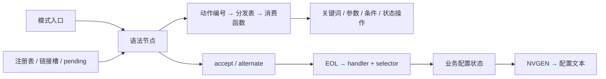

# iosd 的 CLI 挖掘方法

> 样本分析资料：保留适用版本、条件和未知项。原始捕获保留在本地；标注的历史材料路径用于定位来源。


iosd 的命令定义分散在语法节点、动作描述符、模式入口、注册记录和业务函数中。恢复过程将这些对象逐层关联：节点回答“接下来匹配什么”，注册关系回答“这段语法接到哪里”，条件回答“什么上下文允许通过”，handler 与 selector 回答“匹配完成后交给谁处理”。

本文说明仓库中已经实现并实测的方法。当前版本的路径目录、节点图、覆盖统计和剩余动作见 [C8000v 26.01.02 分析结果](../analysis/c8000v-26.01.02/README.md)。环境准备和 IDA 使用从 [主教程](../如何调试iosd.md) 阅读。

## 1 从数据对象建立命令图



节点是图的顶点，accept、alternate 和语义条件边连接后继节点。关键词消费输入文本；参数动作写入解析上下文；条件动作选择分支；EOL 关联业务 handler。动态链接节点连接不同组件提供的片段。NVGEN 沿配置生成流程访问相关定义和回调。

这几个关系分别保存在结果中。一条命令可以含多个关键词节点；一个 handler 可以处理多个 selector；多个模式可以共用入口或片段。

## 2 先确认样本和地址坐标

采集入口记录文件 MD5、架构、位宽、字节序、IDB 路径、imagebase、自动分析和调试状态。映像内地址按实际 ELF 装载段判断并转换为 RVA；堆对象和外部映射地址保留所属运行时坐标。

数据来源包括原始 ELF、saved IDB、暂停内存和 core。IDB 还可能保存以前读入的运行时字节，因此每批记录都带来源和时间。跨批次采集同时记录时间范围与缺页，分析结果说明快照的一致性范围。

在本样本中，运行时节点的部分内部指针采用大端编码并带 bit 63 标记，ELF GOT 使用原生小端编码。读取器按字段和 profile 解码；数值边界、偏移、selector 等整数保留各自含义。

## 3 从分发表核对动作消费者

动作编号连接分发表中的名称和函数。首先对照当前表项的 opcode、名称与目标地址，再阅读实际消费者如何访问描述符。

描述符的长度、字段偏移、字节序和分支行为由消费代码确定。名称适合找入口，字段读写和调用参数提供语义证据。复核后把布局写入核心解码器，把本版本函数 RVA 和身份约束写入 profile。

当前增量已经实现 general keyword、时间、带符号数、十六进制输入、动态数值边界、URL 类参数，以及 ORSET/ORTEST 的 minimum-match 包装。URL 输出 `<url:dynamic>`，同时保留辅助解析器和模式门控；动态数值保存回调及默认范围；尚待复核的 64 位数值动作继续作为未知节点。

### 描述符中的原始关键词

关键词描述符中出现了 `*`、`,` 和 `test http`。旧规则只接受简单单词，使这些节点落入未知类别。现在保留完整字面文本，记录匹配单元、空白及 flags 的解释范围。`*` 作为字面文本保存，`test http` 保持一个描述符的匹配单位，后续通过消费者继续解释输入行为。

这个经验适用于调查：在检查未知节点时，先区分真实缺页、未支持动作和解码器自身的文本限制。

## 4 将节点语义和条件保存在图中

核心 `grammar_semantics` 解码节点，`syntax_paths` 解释图上的输入、条件和状态变化。关键词选项表记录每个选项的文字、值、minimum-match、存储位置与前置条件。参数记录类型、范围、帮助文本和动态回调。

条件记录函数/变量位置、期望结果、求值来源和适用上下文。未知回调保留目标与未解析影响。当前路径模型只跟踪经过复核的 sense、default 和 NVGEN 局部字段；其他条件保持符号形式。具有未知状态影响的回调会使相关跟踪值变为未知。

未知 opcode、描述符缺页和未解析动作作为明确的图节点保存，accept/alternate、上游前缀及下游片段继续可查。未连接到所选模式的定义也保留在候选空间。

## 5 恢复路径与不同语法写法

`recover_saved_cli.py` 从模式入口搜索到 EOL，按较少未知步骤、较少 token、较少边的顺序选择代表路径。每个 EOL 与跟踪上下文保存一条路径见证；同一 handler 的不同 EOL、selector 和上下文分别保留。

这种目录适合快速查询业务入口和参数。完整候选空间由节点图、条件边、选项表和注册记录共同表达。别名、选项组合、循环以及共享片段的其他写法可继续从图中展开；关键词选项的展开还可复用 `option_variants`。每次展开记录搜索上限、循环和待续前沿。

路径中的 `<cr>` 表示终止节点，`<opaque:…>` 表示经过的未知动作，`<number:dynamic>` 等表示带动态约束的参数。`conditions` 保存路径约束，`gaps` 保存语义缺口。即便 `gaps=[]`，权限、上下文及 handler 内部检查仍按各自证据记录。

## 6 区分连接、放行和执行

| 对象 | 取得的证据 |
|---|---|
| 静态定义 | 文件中的节点、注册表和业务函数 |
| 观察到的注册 | 暂停内存中的链接槽、链表及片段成员关系 |
| 条件放行 | 对应状态读取、谓词分支及本次状态值 |
| 实际执行 | 本次输入、权限、模式和 handler 执行结果 |

通用注册分析将触发 handler/selector、状态写入、注册调用、槽位消费和后续片段串联。VPDN 的一次性注册是已经调查的案例；其他命令分别核对其消费者。

`service internal` 已恢复出命令路径、共用 handler 和 selector 20。它的直接门控以及 handler 状态修改见历史运行时分析；当前目录保留符号条件。判断某条后续命令受什么影响时，分别追踪帮助可见性、匹配拒绝和注册变化。

NVGEN 调用业务组件读取配置状态，组织成输出文本。CLI handler 写配置状态，NVGEN 回调读取状态；两者可以共用函数，再通过标志和 selector 选择分支。接口配置缓存的生成、命中和失效另沿缓存入口跟踪。

## 7 复用现有工具

仓库根目录下的离线流程如下，输入路径换成本次实际保存的文件：

```text
python tools/refine_cli_semantics.py --nodes <原节点.jsonl> --summary <原摘要.json> --profile profiles/cli_semantics_26_01_02.json --output <细化目录>
python tools/recover_saved_cli.py --nodes <细化目录>/nodes.jsonl --modes <模式.json> --settings <路径设置.json> --identity <细化目录>/summary.json --layout <ELF布局.json> --output <路径目录> --catalogue <目录.jsonl.gz>
python tools/query_cli_catalogue.py <目录.jsonl.gz> --mode configure --contains "service internal" --limit 10 --json
```

第一步校验源捕获的 SHA256、身份和页面一致性，复用已有页面细化节点；第二步流式写路径，保留上限与前沿；第三步查询结果，`--json` 同时显示参数、条件、效果和缺口。`export_cli_analysis.py` 导出适合仓库保存的派生元数据，包括全部已取得节点、连接和注册对照。

初始图可通过 `export_cli_catalogue.py`、`recover_iosd_syntax.py` 和 `build_candidate_space.py` 建立；运行时图使用 `capture_debugger_memory.py` / `collect_runtime_pages.py` 后接 `export_runtime_grammar.py`。注册与状态调查复用 `audit_registration_triggers.py`、`collect_lifecycle_evidence.py` 和 `analyze_lifecycle.py`。各工具的输入格式见 `--help` 与 [脚本目录](../../script-catalogue.md)。

调试内存读取以暂停状态、映射和独立锚点为前提。core 按自身页面范围读取。历史缺页保持原样，新会话的读取另建记录，随后明确比较。

## 8 当前方法的覆盖范围

本轮校验了 69 份历史捕获并细化 1,778 个节点，其中 1,771 个获得新的动作解释。config 模式的未知/未读节点由 1,557 降为 482。六个模式的符号搜索均处理完本次模型发现的状态，终止前沿和剩余动作随结果保存。

下一批信息价值较高的节点包括 64 位数值、slot/card、IPv4/IPv6 地址、VRF RD，以及动态帮助和协议专用参数。相应函数、描述符和调用上下文是继续复核的入口。完整统计与可查询文件维护在版本目录中，方法文档随通用实现更新。
