# 如何调试 iosd

## 序言

思科的 IOS XE 系统中，iosd 进程是核心的用户态守护进程。它负责管理 CLI、协议处理、配置生成和状态维护等关键功能。调试 iosd 可以帮助开发者和研究人员理解其内部工作机制，分析问题，并进行安全研究。
CSR1000v和C8000v是思科提供的虚拟路由器平台（VNF类），代号都叫做VXE，类似的还有Wireless Controller C9800v等等。本文以 CSR1000v 和 C8000v 为例，介绍如何在虚拟化环境中调试 iosd。

环境准备部分以 **CSR1000v 16.09.06、VMware Workstation 和 Ubuntu Live** 为例

调试环境准备好以后，可以提取 iosd 文件建立静态数据库，再连接运行中的进程，查看命令注册、协议状态和动态对象。本仓库的具体分析案例来自 **C8000v IOS XE 26.01.02**，版本相关地址、结构和统计集中在 [该版本分析结果](analysis/c8000v-26.01.02/README.md)。

## 1 环境与操作顺序

环境中有两种启动方式：安装后的 CSR1000v 从虚拟硬盘启动；Ubuntu Live 从 ISO 启动，用于查看和修改同一块虚拟硬盘。

| 项目 | 本文示例 |
|---|---|
| 虚拟化软件 | VMware Workstation |
| 路由器镜像 | `csr1000v-universalk9.16.09.06.ova` |
| 辅助系统 | Ubuntu Live ISO |
| 本地访问 | 两路虚拟串口，连接到命名管道 |
| 网络访问 | 使用一块 e1000 虚拟网卡作为底层 Linux 通信通道 |
| 分析工具 | IDA；使用与目标架构匹配的调试后端 |

整体顺序如下：

```text
导入 OVA 并完成首次安装
    → 从 Ubuntu Live 启动
    → 挂载路由器磁盘，配置调试启动参数
    → 设置串口和调试网卡
    → 恢复从路由器磁盘启动
    → 通过串口进入底层环境，建立网络通道
    → 提取 iosd，建立 IDB，连接调试器
    → 分析文件结构、CLI 和协议处理
```

## 2 导入并安装 CSR1000v

在 VMware Workstation 中打开 OVA 文件，进入导入向导。

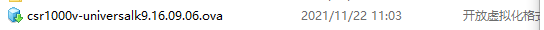

填写虚拟机名称和本地存储位置，继续完成导入。

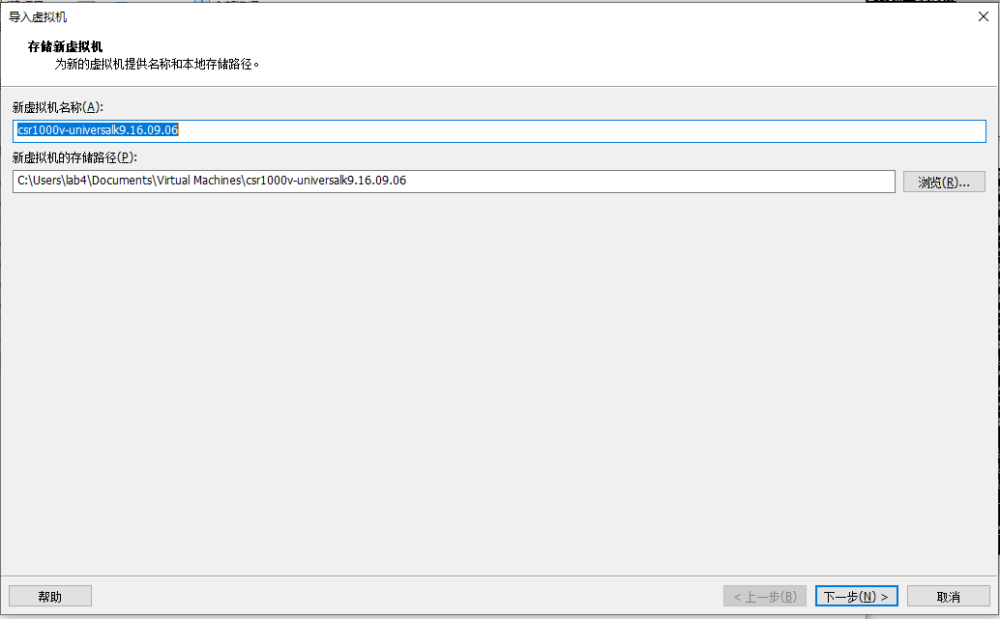

启动虚拟机，让安装程序将系统安装到虚拟磁盘。原文记录的初次启动界面如下。

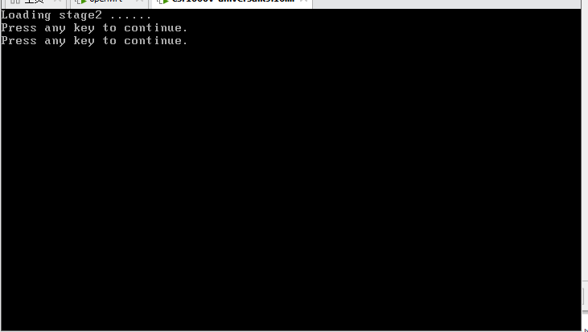

安装完成后关闭虚拟机，准备从 Ubuntu Live 启动。修改引导文件前可以为当前磁盘建立快照，便于重复实验。

## 3 从 Ubuntu Live 启动

在虚拟机的 CD/DVD 设置中选择 Ubuntu Live ISO，并设置光驱在启动时连接。需要立即使用光驱时，同时确认“已连接”状态。

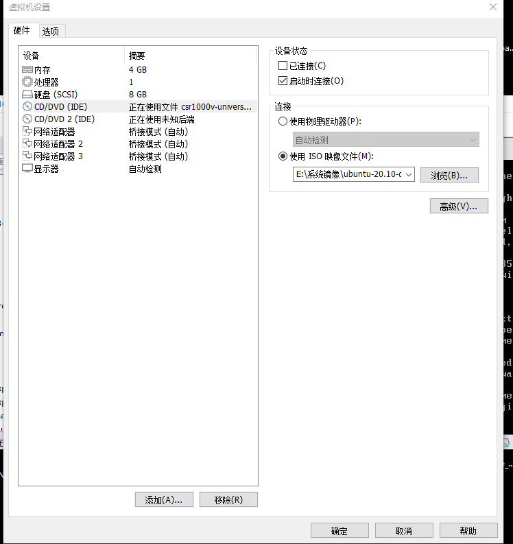

在虚拟机关机状态下，选择“打开电源时进入固件”。

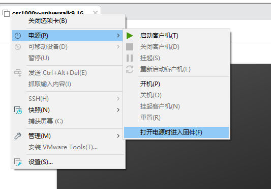

进入固件的 Boot 页面，将 CD-ROM Drive 调整到硬盘之前，保存设置并退出。

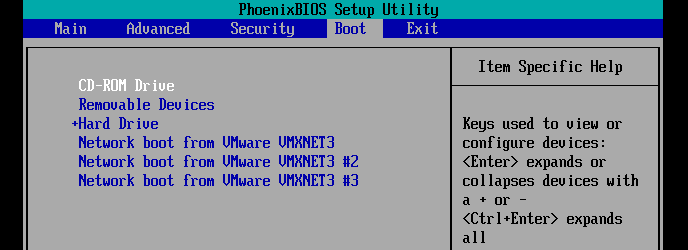

Ubuntu 启动后选择 Live 会话，在这个会话中挂载 CSR1000v 的磁盘。

## 4 查看分区并挂载启动文件所在分区

虚拟磁盘被划分为 9 个分区。Ubuntu 文件管理器可以看到文件系统卷和加密分区。

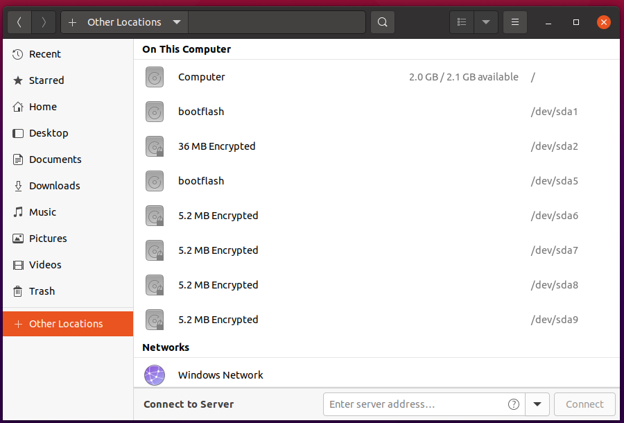

主要分区用途如下。

| 分区 | 加密标记 | 路由器侧挂载点 | 原文记录的内容 |
|---|---|---|---|
| `/dev/sda1` | 无 | `/bootflash` | bootflash 文件 |
| `/dev/sda2` | LUKS | `/nvram` | NVRAM |
| `/dev/sda5` | 无 | `/varied` | GRUB 目录、rpboot、mono 等 pkg 文件 |
| `/dev/sda6` | LUKS | `/csl_p_0` | 许可证、序列号、UDI 等信息 |
| `/dev/sda7` | LUKS | `/csl_p_1` | CSL 相关分区 |
| `/dev/sda8` | LUKS | `/csl_s_0` | CSL 相关分区 |
| `/dev/sda9` | LUKS | `/csl_s_1` | CSL 相关分区 |

Ubuntu 中的卷标、挂载目录和路由器运行时的挂载点分别记录。定位启动文件时，结合分区内容中的 GRUB 目录和 pkg 文件确认目标分区。

以下是 Ubuntu Live 中挂载示例分区的命令：

```sh
lsblk -f
sudo mkdir -p /mnt/csr-boot
sudo mount /dev/sda5 /mnt/csr-boot
ls -la /mnt/csr-boot
```

后文用 `/mnt/csr-boot` 表示这次在 Ubuntu 中选择的挂载目录。使用其他镜像时，先按该镜像的分区布局确定设备名。

## 5 设置 rommon_vars 和调试配置路径

在启动文件所在分区的根目录创建 `rommon_vars`。原文内容如下：

```ini
SR_INIT_SHELL=aux_do_system_shell
SR_INIT_DEBUG=1
SR_TRACE=DEBUG
SR_NOWATCHDOG=1
DEBUG_CONF=/bootflash/debug.conf
```

这些变量供该示例版本的启动流程使用。`DEBUG_CONF` 指定可选调试配置文件的路径，原始文档记录了路径和开关；`debug.conf` 的具体配置内容可以在后续实验中补充。

在当前挂载示例中，文件位置为：

```text
/mnt/csr-boot/rommon_vars
```

## 6 调整 GRUB 引导参数

先在挂载分区内定位现有引导配置。原文列出了 GRUB 2 的 `grub.cfg` 和 GRUB 1 的 `menu.lst` 两种情况，截图展示的是 `menu.lst`。

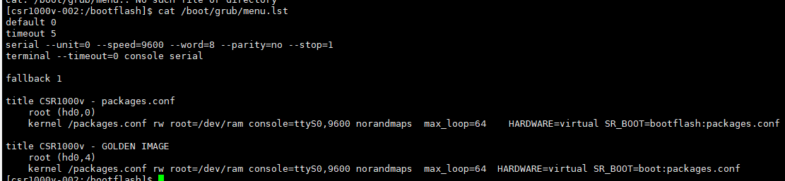

截图中的主要配置如下，路径和启动项保留原示例写法：

```text
default 0
timeout 5
serial --unit=0 --speed=9600 --word=8 --parity=no --stop=1
terminal --timeout=0 console serial

fallback 1

title CSR1000v - packages.conf
    root (hd0,4)
    kernel /packages.conf rw root=/dev/ram console=ttyS0,9600 norandmaps max_loop=64 HARDWARE=virtual SR_BOOT=bootflash:packages.conf

title CSR1000v - GOLDEN IMAGE
    root (hd0,4)
    kernel /packages.conf rw root=/dev/ram console=ttyS0,9600 norandmaps max_loop=64 HARDWARE=virtual SR_BOOT=boot:packages.conf
```

原文的修改包括：移除 `VMCONSOLE`，加入 `console=ttyS0,9600`，并加入 `norandmaps`。串口参数用于将启动控制台接到第一路串口；`norandmaps` 用于该实验中的地址随机化设置，便于后续核对映像地址。

重新启动后，通过目标进程的映射确认实际加载位置。地址记录同时保存文件身份和加载基址，后续 IDA rebase 与调试读取都使用这份对应关系。

编辑完成后，将文件写入磁盘，再卸载 Ubuntu 中的挂载点：

```sh
sync
sudo umount /mnt/csr-boot
```

## 7 配置两路虚拟串口

为虚拟机增加两个串口，连接方式选择命名管道。原文使用的管道名为：

```text
\\.\pipe\csr1000v0
\\.\pipe\csr1000v1
```

第一路串口的配置示例：

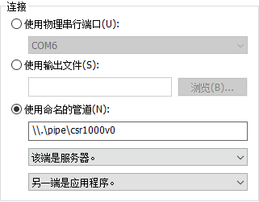

第二路串口的配置示例：

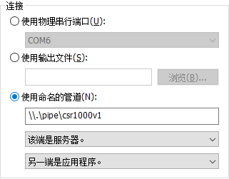

两张截图中，这端配置为服务器，另一端配置为应用程序。主机上的终端程序连接对应管道；与前面引导参数配合时，第一路串口使用 9600 波特率、8 数据位、无校验、1 停止位。
之后可以通过同主机的的终端程序连接两路串口，观察启动输出和进入这个虚拟设备的底层 shell。
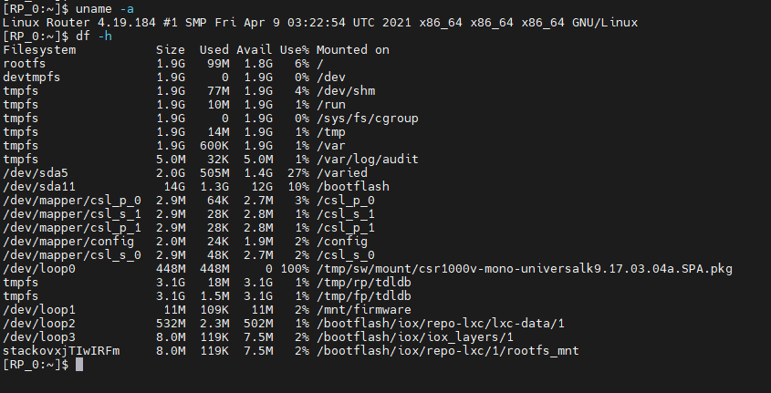
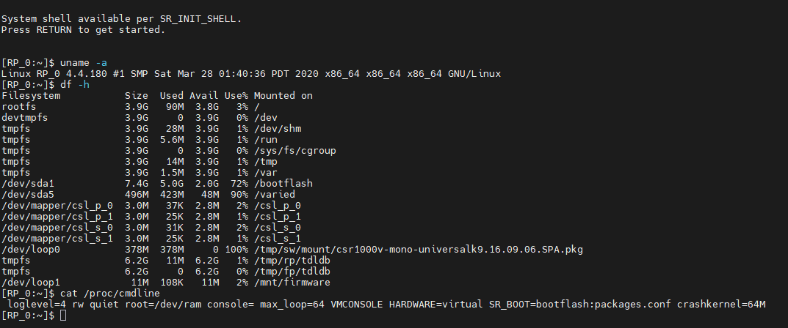

## 8 准备底层 Linux 的网络通道

环境中的转发设施会接管部分虚拟网卡。实验保留 vmxnet3 网卡用于路由器功能，并将其中一块网卡调整为 e1000，使其由底层 Linux 驱动使用。

关闭虚拟机后，用文本编辑器打开 `.vmx` 配置文件。原文截图中的网卡配置为：

```ini
ethernet0.virtualDev = "vmxnet3"
ethernet1.virtualDev = "vmxnet3"
ethernet2.virtualDev = "e1000"
```

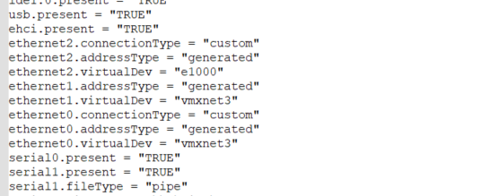

调试网卡连接到主机可以到达的虚拟网络。路由器启动后，通过串口进入底层 shell，查看这块网卡的实际接口名，为它配置地址并启用接口，再从主机验证连通性。

原文还记录了较早 CSR1000v 版本使用的办法：在启动阶段先通过底层 shell 为一块接口配置地址并启用，使该接口作为 Linux 通信通道。网卡类型、接管时机和启动行为随镜像版本核对，实验记录中同时保留这些条件。
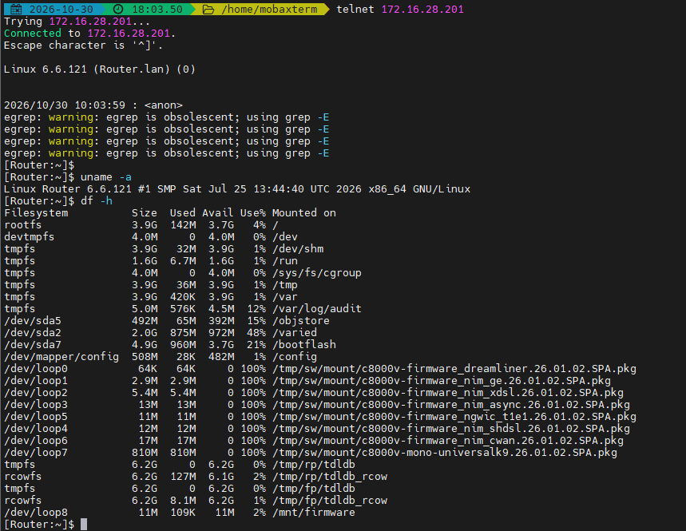
串口用于观察启动和访问底层环境，可以作为初步的命令通道，可以在这个串口上启动预留好的底层网络接口并配置合适的网络地址与路由，之后便可以在外部通过网络访问设备的底层环境，进行文件传输及远程调试通信。原文提到的 telnet 访问需要目标侧已有相应服务；也可以按实验环境使用已有的其他远程访问方式。

## 9 恢复路由器启动并取得 iosd 文件

退出 Ubuntu Live，将启动顺序恢复为路由器虚拟硬盘优先，或断开 Live ISO。连接串口后启动 CSR1000v，观察引导输出以及底层环境是否按配置启动。

在底层环境中找到 iosd 进程及其可执行文件，记录 PID、进程路径和映像映射。Linux 的 `/proc/<PID>/exe` 与 `/proc/<PID>/maps` 可以分别提供进程可执行文件和地址映射线索；其中 `<PID>` 使用本次实际进程号。
或者也可以通过binwalk解包，或者直接在底层找到对应文件然后取出，iosd的ELF文件通常在/usr/binos/bin/下挂载
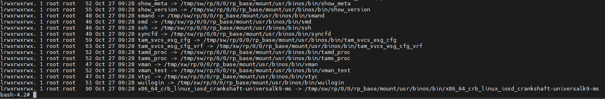

将对应文件复制到分析主机，并计算摘要。例如在 Windows PowerShell 中：

```powershell
Get-FileHash -LiteralPath 'D:\lab\iosd' -Algorithm MD5
Get-FileHash -LiteralPath 'D:\lab\iosd' -Algorithm SHA256
```

文件摘要、IOS XE 版本、架构、提取位置和映射信息一起构成后续分析的样本记录。

## 10 在 IDA 中建立数据库并连接调试器目标

先加载提取的 iosd，确认架构、位宽和 ELF 入口，等待自动分析完成并保存数据库。大型 iosd 的首次分析和调试映射同步可能需要较长时间，状态恢复后再进行后续查询。

远程调试使用与目标平台、架构及 IDA 版本对应的后端。连接目标后，核对当前 PID、可执行文件和运行时映射，再建立 ELF 地址与运行时地址的关系。

对于以零为参考基址的当前分析样本，可以用以下形式记录位置：

```text
运行时地址 = 当前映像基址 + RVA
IDA 地址   = 当前 IDB 基址 + RVA
```

其他 ELF 按其 PT_LOAD 虚拟地址和实际映射计算 load bias。堆对象、线程栈和外部共享库保留各自的地址空间及映射。

在 IDA 中根据已核对的映射执行 rebase，等待处理完成后保存 IDB。随后选择少量代码或只读数据作为锚点，复核文件、数据库和目标映射的对应关系。

需要观察链表、对象或状态时，在调试器中手动暂停目标；读取时记录暂停阶段。继续运行由实验操作者控制。core 文件提供另一个离线观察入口，分析范围由实际捕获的映射和页面决定。
如果想使用IDA或者其他调试器去调试iosd进程，建议只attach而不是启动，因为iosd的启动非常之复杂，而且作为critical process，如果关闭了进程，通常会触发整个系统重启。
对于虚拟设备（例如c8kv csr1kv等）来说，由于其运行在虚拟化环境下，我们可以根据之前的步骤将一个不受数据平面接管的网卡接入到宿主机上，然后在宿主机上使用IDA的远程调试功能去attach到iosd进程上。这里以IDA自带的dbgsrv为例，将IDA配套的dbgsrv传到设备的/bootflash目录下后，找一个其他系统的（比如ubuntu或者centos）libthread_db.so.1过来和dbgsrv放在一起，然后启动监听23946端口。
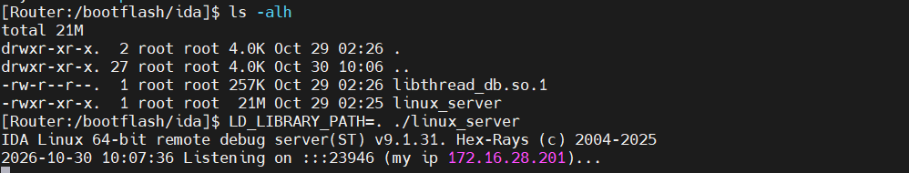
之后在IDA中配置好远程调试的参数并选择目标就可以成功attach到iosd进程上了。需要注意的是，iosd进程在启动时会有很多的初始化工作，如果在iosd启动过程中attach到进程上，可能会导致iosd进程崩溃，所以建议在iosd启动完成后再attach。
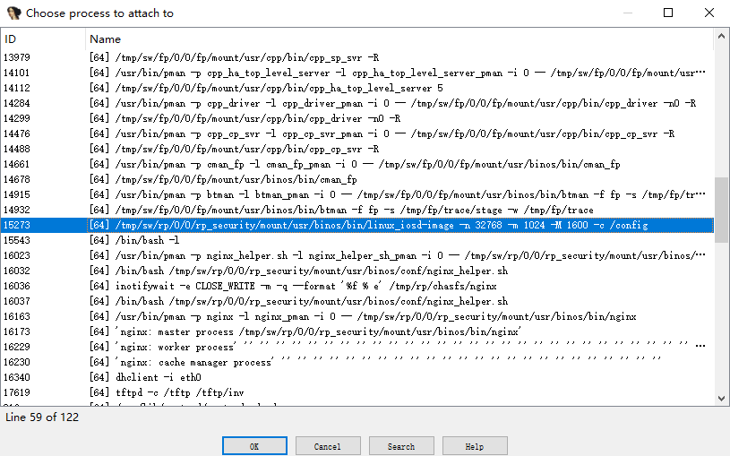
成功连接到调试器之后需要注意，IOSD程序通过倒计时timer机制来进行某种心跳机制，没过一段时间会由系统向IOSD发送一个信号，如果IOSD没有在规定时间内重置这个timer，IOSD进程间就会收到这个信号，从而触发崩溃突出。
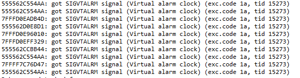

我们需要在调试器中设置对收到信号的处理方式：不暂停应用，不将信号传递给应用，制作记录，这样就可以避免IOSD进程崩溃了。


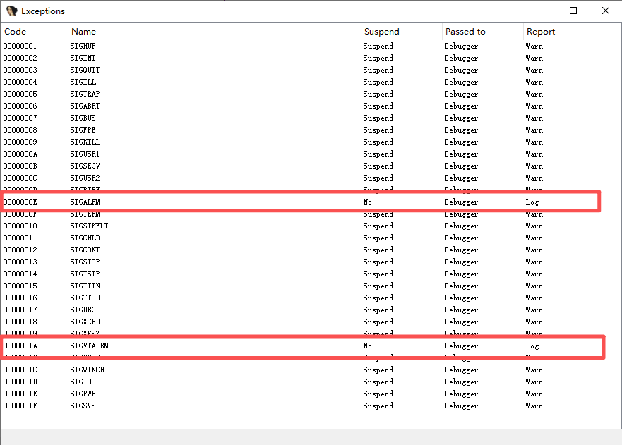

## 11 ISR4321为例的调试
基于Cisco XE系统的实体设备通常和虚拟设备共用代码，但是仍然会有很大的区别，想在实体设备上调试不是一个简单的事情，首先就是获取到底层的root权限，这一步通常需要用到漏洞，也就决定了需要用到历史漏洞，而且往往只能在特定的版本上才能使用。
假设我们使用公开的漏洞获取到了实体设备的root权限，如何给调试器提供通信渠道也是个麻烦事儿，通常需要考虑建立一个独立于被调试对象以外的通道。这里列举三种可能的手段：
1. 用实体设备的串口，
2. 给实体设备增加一个USB网卡，新增加的USB网卡独属于底层Linux系统，和IOSD进程无关，也和数据平面无关，使用这个网卡作为调试器和IOSD进程的通信通道。好在某些设备幸好上，usbnet网卡和相关的驱动没有完全剪裁掉。
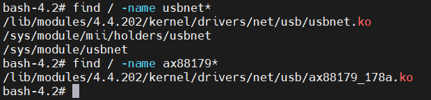
3. 使用mcp_chvrf.sh
   在较新的Cisco XE系统中，mcp_chvrf.sh增加了一个global VRF空间，可以从底层访问设备以外的网络。
   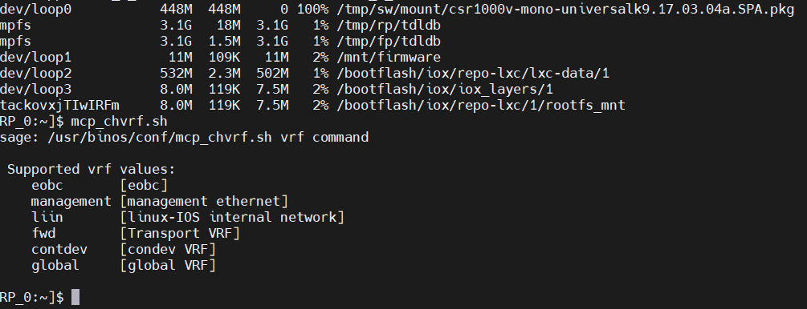
    不过在一些老版本中，mcp_chvrf.sh并没有global VRF空间，这时候就需要其他方法了。
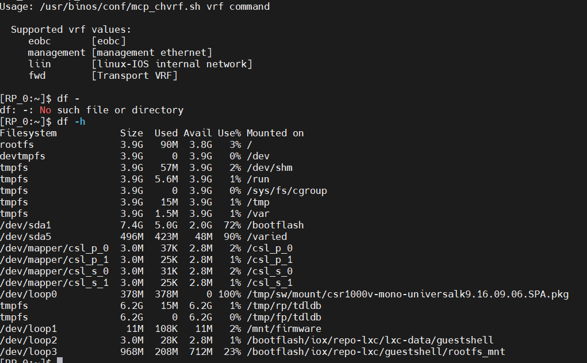
## 11 用 skill 辅助分析

仓库中的 [iosd-analysis skill](skills/iosd-analysis/SKILL.md) 复用了字节读取、CLI 图恢复、注册分析和协议调查脚本。IDA MCP 提供当前数据库和调试接口，skill 组织调查过程及解释资料。

在当前项目对话中可以这样开始：

> 读取 skills/iosd-analysis/SKILL.md。先核对当前样本身份与 IDA 会话，再从初始化入口解释这个 iosd 的组织方式，列出本次使用的证据和已经取得的处理关系。

Python 入口也可以直接使用。以下命令在仓库根目录运行，`<MCP地址>` 替换为当前 IDA 实例实际显示的地址：

```text
python tools/iosd_mcp.py --url <MCP地址> discover --output reports/session/capabilities.json
python tools/iosd_mcp.py --url <MCP地址> status --output reports/session/session.json
```

`status` 保存数据库身份、当前基址、自动分析与调试状态。后续调用引用这个 session；重新加载 IDB、rebase 或重启 IDA 后重新建立对应记录。

调试读取、动态链接槽和 core 的请求格式见 [运行时与 core](skills/iosd-analysis/references/runtime-and-core.md)。

## 12 阅读 iosd 的内容与结构

开始阅读时，可以先看四组关系：

| 视角 | 主要内容 |
|---|---|
| 文件和进程 | 主 ELF、共享库、映射以及与其他进程的接口 |
| 初始化 | subsystem 记录、module 分组和依赖、init 回调 |
| 连接和执行 | registry、函数指针槽、队列、IOS task、Linux 线程 |
| 业务与状态 | CLI、协议输入、定时器、配置状态、NVGEN 和主备事件 |

这些关系把文件中的代码入口连接到具体工作。例如，某个 subsystem init 可以登记接收回调并建立队列；协议 task 从队列取包，检查字段并更新邻居状态。CLI handler 修改组件配置，NVGEN 回调再将状态组织成配置文本。

配图及具体实现见 [iosd 架构图解](docs/iosd架构图解.html) 和 [从大 ELF 到运行机制](docs/iosd从大ELF到运行机制.md)。

## 13 CLI 挖掘的基本过程

CLI 分析从动作分发表、语法节点、模式入口和注册接口展开。先恢复节点之间的 accept、alternate 和动态链接关系，再沿路径关联关键词、参数、条件、handler 与 selector。

分析结果按以下层次记录：

| 层次 | 记录内容 |
|---|---|
| 定义 | 节点、动作、描述符、关键词与参数 |
| 语法路径 | 完整路径、前缀、片段、条件和终结 handler |
| 注册 | 静态注册表、动态链接槽、待绑定记录及其来源 |
| 状态 | 条件读取、状态写入、一次性注册与回调目标 |
| 配置生成 | NVGEN 节点、业务回调、对象迭代和输出 |

逐条语法动作的含义由消费代码确认。运行时快照补充实际槽位、链表及状态；尚待解释的动作和间接分支保留到结果中，便于继续追踪。

CLI 的具体方法、脚本入口和本版本恢复进度见 [CLI 挖掘方法](docs/iosd的CLI挖掘方法.md) 与 [C8000v 26.01.02 分析结果](analysis/c8000v-26.01.02/README.md)。

## 14 协议处理与配置生成

协议调查可以从相关 subsystem init 和登记回调进入，再沿输入缓冲区、队列消费者、字段解析、错误处理和状态更新追踪。文件归属通过实际函数位置、导入绑定和外部消费端逐段确定。

现有案例中，CDP 展示接收回调、队列、内部 task、头与 TLV 检查以及邻居缓存；BGP 展示消息类型与会话状态参与的分发；OSPF 展示取包后的消息类型处理；EHSA 展示心跳、事件过滤、状态机和平台回调的协作。

配置生成沿另一个方向工作：业务回调读取组件状态，经 NVGEN 公共输出设施形成配置文本。hostname 和接口 description 已有 CLI 与生成回调的关联案例，详见 [NVGEN 与接口配置缓存](docs/iosd的NVGEN与接口配置缓存.md)。
