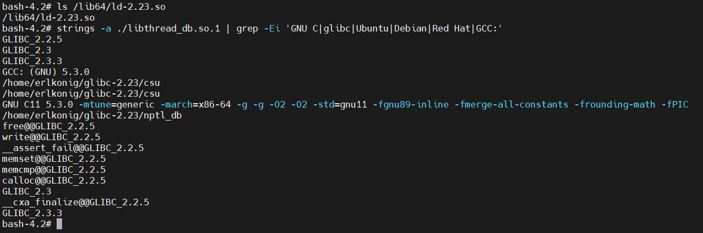
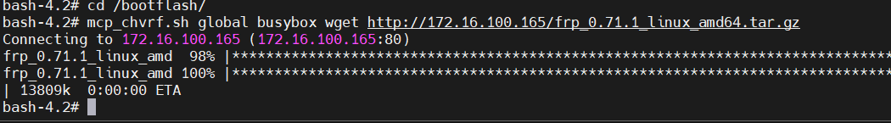
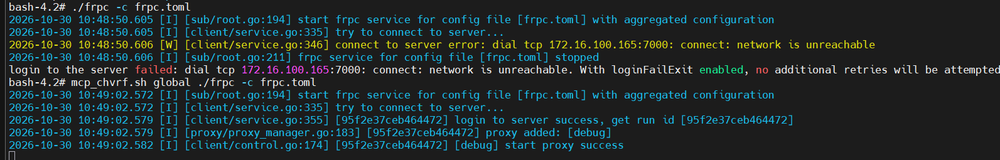
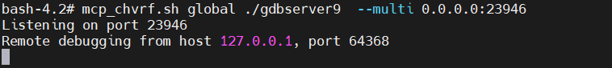
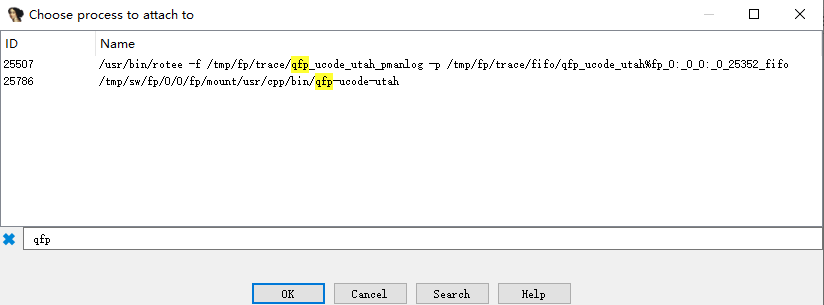

# 如何调试 iosd

## 序言

思科的 IOS XE 系统中，iosd 进程是核心的用户态守护进程。它负责管理 CLI、协议处理、配置生成和状态维护等关键功能。调试 iosd 可以帮助开发者和研究人员理解其内部工作机制，分析问题，并进行安全研究。
CSR1000v 和 C8000v 是思科提供的 IOS XE 虚拟路由器平台，Catalyst 9800-CL 则是运行 IOS XE 的虚拟无线控制器。本文以 CSR1000v 和 C8000v 为例，介绍如何在虚拟化环境中调试 iosd。当前分析样本的文件名中包含 `vxe` 平台标记。

环境准备部分以 **CSR1000v 16.09.06、VMware Workstation 和 Ubuntu Live** 为例。

调试环境准备好以后，可以提取 iosd 文件建立静态数据库，再连接运行中的进程，查看命令注册、协议状态和动态对象。本仓库的具体分析案例来自 **C8000v IOS XE 26.01.02**，版本相关地址、结构和统计集中在 [该版本分析结果](analysis/c8000v-26.01.02/README.md)。

本文同时作为仓库的完整使用说明：前半部分准备调试环境，后半部分介绍 skill 安装、MCP 使用、程序结构与 CLI 分析，最后说明源码和文档的维护方式。

| 阅读入口 | 内容 |
|---|---|
| 本文 | 调试教程、skill 安装使用与仓库维护 |
| [iosd-analysis skill](skills/iosd-analysis/SKILL.md) | 调查流程、经验模式、解析工具与按需参考知识 |
| [版本分析结果](analysis/c8000v-26.01.02/README.md) | 当前样本的架构证据、协议处理链、CLI 数据与覆盖范围 |
| [架构图解](docs/iosd架构图解.html) | 八张关系图与离线阅读页，支持搜索、主题筛选和地址细节显示 |

IDA MCP 提供当前 IDB 和调试数据，Python 核心执行结构解析，skill 组织调查和讲解。已有本地报告及捕获可直接复用，未知和不完整分支继续保留。

## 1 环境与操作顺序

环境中有两种启动方式：安装后的 CSR1000v 从虚拟硬盘启动；Ubuntu Live 从 ISO 启动，用于查看和修改同一块虚拟硬盘。

| 项目 | 本文示例 |
|---|---|
| 虚拟化软件 | VMware Workstation |
| 路由器镜像 | `csr1000v-universalk9.16.09.06.ova` |
| 辅助系统 | Ubuntu Live ISO |
| 本地访问 | 两路虚拟串口，连接到命名管道 |
| 网络访问 | 使用一块 e1000 虚拟网卡作为底层 Linux 通信通道 |
| 分析工具 | IDA；使用与目标架构匹配的调试后端 |

整体顺序如下：

```text
导入 OVA 并完成首次安装
    → 从 Ubuntu Live 启动
    → 挂载路由器磁盘，配置调试启动参数
    → 设置串口和调试网卡
    → 恢复从路由器磁盘启动
    → 通过串口进入底层环境，建立网络通道
    → 提取 iosd，建立 IDB，连接调试器
    → 分析文件结构、CLI 和协议处理
```

## 2 导入并安装 CSR1000v

在 VMware Workstation 中打开 OVA 文件，进入导入向导。


填写虚拟机名称和本地存储位置，继续完成导入。


启动虚拟机，让安装程序将系统安装到虚拟磁盘。初次启动界面如下。


安装完成后关闭虚拟机，准备从 Ubuntu Live 启动。修改引导文件前可以为当前磁盘建立快照，便于重复实验。

## 3 从 Ubuntu Live 启动

在虚拟机的 CD/DVD 设置中选择 Ubuntu Live ISO，并设置光驱在启动时连接。需要立即使用光驱时，同时确认“已连接”状态。


在虚拟机关机状态下，选择“打开电源时进入固件”。


进入固件的 Boot 页面，将 CD-ROM Drive 调整到硬盘之前，保存设置并退出。


Ubuntu 启动后选择 Live 会话，在这个会话中挂载 CSR1000v 的磁盘。

## 4 查看分区并挂载启动文件所在分区

Ubuntu 文件管理器可以看到路由器磁盘中的文件系统卷和加密分区。分区数量、编号和用途随镜像版本核对，下面列出示例环境中的主要分区。


主要分区用途如下。

| 分区 | 加密标记 | 路由器侧挂载点 | 主要内容 |
|---|---|---|---|
| `/dev/sda1` | 无 | `/bootflash` | bootflash 文件 |
| `/dev/sda2` | LUKS | `/nvram` | NVRAM |
| `/dev/sda5` | 无 | `/varied` | GRUB 目录、rpboot、mono 等 pkg 文件 |
| `/dev/sda6` | LUKS | `/csl_p_0` | 许可证、序列号、UDI 等信息 |
| `/dev/sda7` | LUKS | `/csl_p_1` | CSL 相关分区 |
| `/dev/sda8` | LUKS | `/csl_s_0` | CSL 相关分区 |
| `/dev/sda9` | LUKS | `/csl_s_1` | CSL 相关分区 |

Ubuntu 中的卷标、挂载目录和路由器运行时的挂载点分别记录。定位启动文件时，结合分区内容中的 GRUB 目录和 pkg 文件确认目标分区。

以下是 Ubuntu Live 中挂载示例分区的命令：

```sh
lsblk -f
sudo mkdir -p /mnt/csr-boot
sudo mount /dev/sda5 /mnt/csr-boot
ls -la /mnt/csr-boot
```

后文用 `/mnt/csr-boot` 表示这次在 Ubuntu 中选择的挂载目录。使用其他镜像时，先按该镜像的分区布局确定设备名。

## 5 设置 rommon_vars 和调试配置路径

在启动文件所在分区的根目录创建 `rommon_vars`，写入以下内容：

```ini
SR_INIT_SHELL=aux_do_system_shell
SR_INIT_DEBUG=1
SR_TRACE=DEBUG
SR_NOWATCHDOG=1
DEBUG_CONF=/bootflash/debug.conf
```

这些变量供该示例版本的启动流程使用。`DEBUG_CONF` 指定调试配置文件路径；`debug.conf` 的具体内容和读取行为随后结合对应版本的启动代码补充。

在当前挂载示例中，文件位置为：

```text
/mnt/csr-boot/rommon_vars
```

## 6 调整 GRUB 引导参数

先在挂载分区内定位现有引导配置。GRUB 2 使用 `grub.cfg`，GRUB Legacy 使用 `menu.lst`；下面的示例为 `menu.lst`。


主要配置如下，路径和启动项对应本节示例环境：

```text
default 0
timeout 5
serial --unit=0 --speed=9600 --word=8 --parity=no --stop=1
terminal --timeout=0 console serial

fallback 1

title CSR1000v - packages.conf
    root (hd0,4)
    kernel /packages.conf rw root=/dev/ram console=ttyS0,9600 norandmaps max_loop=64 HARDWARE=virtual SR_BOOT=bootflash:packages.conf

title CSR1000v - GOLDEN IMAGE
    root (hd0,4)
    kernel /packages.conf rw root=/dev/ram console=ttyS0,9600 norandmaps max_loop=64 HARDWARE=virtual SR_BOOT=boot:packages.conf
```

修改包括：移除 `VMCONSOLE`，加入 `console=ttyS0,9600`，并加入 `norandmaps`。串口参数将启动控制台接到第一路串口；`norandmaps` 关闭用户态地址空间随机化，便于核对映像地址。参数含义见 [Linux 内核文档](https://www.kernel.org/doc/html/v4.17/admin-guide/kernel-parameters.html)。

重新启动后，通过目标进程的映射确认实际加载位置。地址记录同时保存文件身份和加载基址，后续 IDA rebase 与调试读取都使用这份对应关系。

编辑完成后，将文件写入磁盘，再卸载 Ubuntu 中的挂载点：

```sh
sync
sudo umount /mnt/csr-boot
```

## 7 配置两路虚拟串口

为虚拟机增加两个串口，连接方式选择命名管道。示例管道名为：

```text
\\.\pipe\csr1000v0
\\.\pipe\csr1000v1
```

第一路串口的配置示例：


第二路串口的配置示例：


两张截图中，这端配置为服务器，另一端配置为应用程序。主机上的终端程序连接对应管道；与前面引导参数配合时，第一路串口使用 9600 波特率、8 数据位、无校验、1 停止位。
之后通过宿主机上的终端程序连接两路串口，观察启动输出并进入虚拟设备的底层 shell。


## 8 准备底层 Linux 的网络通道

环境中的转发设施会接管部分虚拟网卡。实验保留 vmxnet3 网卡用于路由器功能，并将其中一块网卡调整为 e1000，使其由底层 Linux 驱动使用。

关闭虚拟机后，用文本编辑器打开 `.vmx` 配置文件。网卡配置示例如下：

```ini
ethernet0.virtualDev = "vmxnet3"
ethernet1.virtualDev = "vmxnet3"
ethernet2.virtualDev = "e1000"
```


调试网卡连接到主机可以到达的虚拟网络。路由器启动后，通过串口进入底层 shell，查看这块网卡的实际接口名，为它配置地址并启用接口，再从主机验证连通性。

较早的部分 CSR1000v 环境还可以在启动阶段通过底层 shell 为接口配置地址并启用，将其保留为 Linux 通信通道。网卡类型、接管时机和启动行为按镜像版本记录。


串口用于观察启动和访问底层环境。通过串口为预留接口配置地址与路由，确认连通性后，便可使用网络进行文件传输和远程调试。截图中的 telnet 连接使用目标侧已经运行的服务，实际环境也可使用已有的其他远程访问方式。

## 9 恢复路由器启动并取得 iosd 文件

退出 Ubuntu Live，将启动顺序恢复为路由器虚拟硬盘优先，或断开 Live ISO。连接串口后启动 CSR1000v，观察引导输出以及底层环境是否按配置启动。

在底层环境中找到 iosd 进程及其可执行文件，记录 PID、进程路径和映像映射。Linux 的 `/proc/<PID>/exe` 与 `/proc/<PID>/maps` 可以分别提供进程可执行文件和地址映射线索；其中 `<PID>` 使用本次实际进程号。
另一种方式是解包对应系统镜像，再定位 iosd ELF；binwalk 可以辅助识别和提取镜像中的文件系统。运行中的系统通常在 `/usr/binos/bin/` 下提供程序入口，其中部分是指向已挂载软件包的符号链接。使用 `readlink -f` 确认实际文件位置，并与 `/proc/<PID>/exe` 对照。


将对应文件复制到分析主机，并计算摘要。例如在 Windows PowerShell 中：

```powershell
Get-FileHash -LiteralPath 'D:\lab\iosd' -Algorithm MD5
Get-FileHash -LiteralPath 'D:\lab\iosd' -Algorithm SHA256
```

文件摘要、IOS XE 版本、架构、提取位置和映射信息一起构成后续分析的样本记录。

## 10 在 IDA 中建立数据库并连接调试器目标

先加载提取的 iosd，确认架构、位宽和 ELF 入口，等待自动分析完成并保存数据库。大型 iosd 的首次分析和调试映射同步可能需要较长时间，状态恢复后再进行后续查询。

远程调试使用与目标平台、架构及 IDA 版本对应的后端。连接目标后，核对当前 PID、可执行文件和运行时映射，再建立 ELF 地址与运行时地址的关系。

对于以零为参考基址的当前分析样本，可以用以下形式记录位置：

```text
运行时地址 = 当前映像基址 + RVA
IDA 地址   = 当前 IDB 基址 + RVA
```

其他 ELF 按其 PT_LOAD 虚拟地址和实际映射计算 load bias。堆对象、线程栈和外部共享库保留各自的地址空间及映射。

在 IDA 中根据已核对的映射执行 rebase，等待处理完成后保存 IDB。随后选择少量代码或只读数据作为锚点，复核文件、数据库和目标映射的对应关系。

需要观察链表、对象或状态时，在调试器中手动暂停目标；读取时记录暂停阶段。继续运行由实验操作者控制。core 文件提供另一个离线观察入口，分析范围由实际捕获的映射和页面决定。
### 10.1 启动远程调试服务端并 attach

iosd 的启动依赖平台初始化、进程管理和其他组件。本教程在系统启动完成后 attach 到已有进程。iosd 属于系统关键进程，其退出会触发平台的故障处理；具体恢复或重启行为由平台策略决定。

对于 C8000v、CSR1000v 等虚拟设备，使用前面准备的底层 Linux 网络接口连接分析主机。将与 IDA 版本及目标架构对应的 Linux 远程调试服务端 `linux_server` 放到设备上，例如 `/bootflash/ida/`。

截图中的实验环境还在同一目录放置了线程调试辅助库 `libthread_db.so.1`，下一节记录这次使用文件的构建线索。

```sh
cd /bootflash/ida
chmod +x ./linux_server
LD_LIBRARY_PATH=. ./linux_server
```

示例服务端监听 23946 端口，以实际启动输出为准。


在 IDA 中配置远程主机和端口，打开进程列表，依据 PID、命令行及可执行文件路径选择本次目标。截图中的进程名包含 `linux_iosd-image`；对当前样本使用 `/proc/<PID>/exe` 核对它与提取的 ELF 的对应关系。


### 10.2 本次使用的 libthread_db.so.1

本次实验使用的 `libthread_db.so.1` 已配合调试服务端完成连接。截图显示，目标环境中存在 `/lib64/ld-2.23.so`，库中保留了 `glibc-2.23` 构建路径和 `GCC 5.3.0` 字符串。这些信息描述本次使用环境和文件的构建线索。

替换辅助库时，按目标架构选择文件，并通过服务端启动、线程列表和调用栈读取检查实际兼容性。



### 10.3 暂停后的定时信号处理

本次实验的现场记录是：手动暂停 iosd 一段时间后，IDA 出现定时信号提示。操作者回忆，选择 `Pass to program` 将信号传递给 iosd 后，进程曾崩溃退出。对应截图记录了 `SIGVTALRM`；该现象的具体触发条件与退出路径仍需结合信号处理入口或退出现场核对。


本实验采用截图中的处理方式：

| 信号 | Suspend | Passed to | Report |
|---|---|---|---|
| `SIGALRM` | No | Debugger | Log |
| `SIGVTALRM` | No | Debugger | Log |

即由调试器处理这两个信号并记录日志。出现相应提示时保持这一策略，避免在该实验中选择 `Pass to program`。这是本次现场采用的设置；其他信号按各自的处理职责配置。IDA 将“收到信号时是否暂停”和“是否交给程序”作为独立选项，详见 [IDA 异常处理说明](https://docs.hex-rays.com/9.0/user-guide/user-interface/menu-bar/debugger/exceptions)。


Linux 的常规 interval timer 中，`SIGALRM` 对应实时时间，`SIGVTALRM` 对应进程消耗的用户态 CPU 时间。分析暂停期间的信号时，同时核对未处理信号、线程停止范围和发送者。一般计时器语义见 [GNU C Library 文档](https://sourceware.org/glibc/manual/2.24/html_node/Setting-an-Alarm.html)。

当前 C8000v 26.01.02 样本已确认创建 `IOSXE heartbeat process`，任务内调用 `__be_mcp_emit_heartbeat`，并存在通向 `_be_crashdump` 的失败分支；它还调用 `__be_unix_start_hogcheck_periodic`。这些关系说明了心跳与监测入口，定时信号的发送、处理及现场退出之间的关联继续保留为待核对关系。具体函数与范围见 [调试信号与心跳代码复核](docs/iosd调试信号与心跳.md)。

## 11 以 ISR4321 为例调试实体设备

实体设备与虚拟设备共享部分 IOS XE 实现，硬件驱动、数据平面和底层访问方式则随平台变化。本节以已经取得设备底层 root shell 的实验环境为前提，重点讨论调试通信通道。

调试通道由底层环境维持，便于在 iosd 暂停时继续通信。可以结合设备条件选择以下方式。

### 11.1 串口

串口用于进入底层 shell、观察日志和准备调试环境。使用串口承载远程调试协议时，还需要匹配相应调试后端的传输能力。

### 11.2 USB 网卡

可以给设备接入由底层 Linux 驱动管理的 USB 网卡，建立独立调试链路。截图显示某个实验镜像保留了 `usbnet` 与 AX88179 相关驱动文件；接入后继续核对 USB 设备识别、驱动绑定、网络接口和通信结果。


### 11.3 使用 mcp_chvrf.sh 提供的网络环境

部分版本的 `mcp_chvrf.sh` 提供 `global` 选项，允许在对应网络环境中启动命令。实验中通过这一方式下载工具，并启动 frpc 连接分析主机上的 frp 服务端。



截图显示直接运行 frpc 时出现 `network is unreachable`；通过 `mcp_chvrf.sh global` 启动后，成功登录服务端并建立代理。随后按 frp 配置将连接转发到设备上的调试服务端端口。



接着在设备上启动调试服务端。本节截图使用 GDB remote 服务端 `gdbserver9`，在 IDA 中选择 **Remote GDB debugger**。服务端文件名沿用该实验中的名称，启动方式如下：

```sh
mcp_chvrf.sh global ./gdbserver9 --multi 0.0.0.0:23946
```



使用 frp 时，连接方向为：

```text
IDA → frp 服务端的代理端口 → frp 通道 → 设备上的调试服务端端口
```

IDA 填写 frp 代理对外提供的地址与端口；frpc 的本地转发目标填写设备上可达的调试服务端地址与端口。本例中设备的调试服务端监听 23946，代理对外提供的端口由 frp 配置确定。frpc 登录 frp 服务端所用的控制连接端口单独配置。

当分析主机到设备出口地址的路由可达，且调试服务端在对应网络环境中监听可达地址时，也可以直接连接设备上的服务端端口。

连接后在 IDA 中选择目标 PID。下面的截图展示了按 `qfp` 筛选出的 `qfp-ucode-utah` 数据平面进程，可用于数据平面代码调查；调试 iosd 时，按照前面记录的 iosd PID 与可执行文件路径选择相应进程。GDB 后端连接方式见 [IDA Remote GDB 文档](https://docs.hex-rays.com/9.1/user-guide/debugger/remote-debugging/remote-gdb-debugger)。



脚本的可用选项按设备上的使用说明核对。网络命名空间与 VRF 的具体切换方式由该版本脚本实现确定。下面两张截图展示了不同实验环境中的选项差异。


第一张截图列出 `eobc`、`management`、`liin`、`fwd`、`contdev`、`global` 六个选项；另一环境列出 `eobc`、`management`、`liin`、`fwd` 四个选项。根据设备实际提供的网络环境选择调试通道，串口和 USB 网卡等方式见前两节。


## 12 用 skill 辅助分析

仓库中的 [iosd-analysis skill](skills/iosd-analysis/SKILL.md) 复用了字节读取、CLI 图恢复、注册分析和协议调查脚本。IDA MCP 提供当前数据库和调试接口，skill 组织调查过程及解释资料。

### 12.1 安装与提出问题

将整个 `skills/iosd-analysis` 文件夹复制到客户端支持的 skills 目录，保持 `SKILL.md`、`references`、`scripts` 和 `agents` 的相对位置。也可以由支持从仓库安装 skill 的客户端安装这个子目录。

按客户端配置连接实际的 IDA MCP 服务。连接地址由本次运行环境提供，skill 随附代码支持 Python 3.10+。在支持该 skill 的客户端中，可以这样提出问题：

> 使用 $iosd-analysis，从初始化入口解释当前 iosd 的组织方式，说明 subsystem、module、registry 和执行上下文之间已经取得的关系。

> 使用 $iosd-analysis，分析当前 iosd 的 CDP 报文处理入口，关联子系统、登记回调和解析函数，保留未知分支。

> 使用 $iosd-analysis，对照 CLI 定义和暂停进程中的链接槽，解释 config 模式下命令的注册关系与状态条件。

在当前仓库对话中，也可以直接要求读取入口文件：

> 读取 skills/iosd-analysis/SKILL.md。先核对当前样本身份与 IDA 会话，再从初始化入口解释这个 iosd 的组织方式，列出本次使用的证据和已经取得的处理关系。

### 12.2 使用 MCP 入口

以下命令在仓库根目录运行，`<MCP地址>` 替换为当前 IDA 实例实际显示的地址：

```text
python tools/iosd_mcp.py --url <MCP地址> discover --output reports/session/capabilities.json
python tools/iosd_mcp.py --url <MCP地址> status --output reports/session/session.json
python tools/iosd_mcp.py --url <MCP地址> protocol --session reports/session/session.json --query cdp --output reports/session/cdp.json
```

`discover` 取得工具能力，`status` 保存数据库身份、当前基址、自动分析与调试状态。后续调用引用这个 session；重新加载 IDB、rebase 或重启 IDA 后重新建立对应记录。也可用 `IOSD_IDA_MCP_URL` 环境变量配置地址。

随附入口通过 MCP 的 `py_eval` 运行短采集脚本；其他 MCP 提供的类型化接口按其实际 schema 适配。完整参数见 `--help` 和 [MCP 会话说明](skills/iosd-analysis/references/mcp-and-session.md)。独立安装 skill 后，同一入口位于 `<skill>/scripts/iosd_mcp.py`。

### 12.3 数据来源和常用功能

| 数据源 | 主要用途 | 解释范围 |
|---|---|---|
| saved IDB | 字节、函数、引用、组织结构与语法候选 | 保存字节的来源随会话记录，其中可能包括历史运行时数据 |
| 已暂停的调试进程 | 动态槽、链表、堆对象、状态及实际库绑定 | 核对样本、运行时基址和独立锚点，按采集阶段解释 |
| ELF core | 离线读取已经捕获的映射和页面 | 当前支持未压缩 ELF64 x86-64；缺失页面保留为缺口 |

入口还提供 `read`、`function`、`relationships`、`subsystems`、`linkage` 和 `core-read`。`linkage` 分批读取动态槽、待绑定链表与状态，保存限额、缺页及续读位置。

离线组件目录入口为：

```text
python tools/iosd_mcp.py components --query ospf --output reports/session/components-ospf.json
```

组件索引按类别、名称词元和记录 ID 查找入口，保留同名记录及未知项。当前样本索引包含 5,692 条记录，含 15 条同名 `cerrno_init` 和 8 条未记录 init RVA 的实体。详情见 [组件索引与协议调查入口](docs/iosd组件索引与协议调查入口.md)。

协议线索扫描可通过 `protocol --resume <上一页.json>` 继续前一次名称或字符串扫描，保留各页结果和未读范围。继续方式及处理链调查方法见 [协议调查](skills/iosd-analysis/references/protocols.md)。

调试读取、动态链接槽和 core 的请求格式见 [运行时与 core](skills/iosd-analysis/references/runtime-and-core.md)。

### 12.4 协调 IDA 操作

IDA 执行 rebase、attach 或其他交互脚本期间，先处理已有的本地材料，待界面恢复后继续采集。MCP 请求在同一实例上串行执行；客户端超时后保留 pending 记录，确认 IDA 空闲后恢复。

目标暂停与继续由实验操作者控制。结果中分别记录定义、观察到的连接、条件求值和执行证据，并注明本次读取的数据来源。

## 13 阅读 iosd 的内容与结构

开始阅读时，可以先看四组关系：

| 视角 | 主要内容 |
|---|---|
| 文件和进程 | 主 ELF、共享库、映射以及与其他进程的接口 |
| 初始化 | subsystem 记录、module 分组和依赖、init 回调 |
| 连接和执行 | registry、函数指针槽、队列、IOS task、Linux 线程 |
| 业务与状态 | CLI、协议输入、定时器、配置状态、NVGEN 和主备事件 |

这些关系把文件中的代码入口连接到具体工作。例如，某个 subsystem init 可以登记接收回调并建立队列；协议 task 从队列取包，检查字段并更新邻居状态。CLI handler 修改组件配置，NVGEN 回调再将状态组织成配置文本。

配图及具体实现见 [iosd 架构图解](docs/iosd架构图解.html) 和 [从大 ELF 到运行机制](docs/iosd从大ELF到运行机制.md)。

## 14 CLI 挖掘的基本过程

CLI 分析从动作分发表、语法节点、模式入口和注册接口展开。先恢复节点之间的 accept、alternate 和动态链接关系，再沿路径关联关键词、参数、条件、handler 与 selector。

分析结果按以下层次记录：

| 层次 | 记录内容 |
|---|---|
| 定义 | 节点、动作、描述符、关键词与参数 |
| 语法路径 | 完整路径、前缀、片段、条件和终结 handler |
| 注册 | 静态注册表、动态链接槽、待绑定记录及其来源 |
| 状态 | 条件读取、状态写入、一次性注册与回调目标 |
| 配置生成 | NVGEN 节点、业务回调、对象迭代和输出 |

逐条语法动作的含义由消费代码确认。运行时快照补充实际槽位、链表及状态；尚待解释的动作和间接分支保留到结果中，便于继续追踪。

CLI 的具体方法、脚本入口和本版本恢复进度见 [CLI 挖掘方法](docs/iosd的CLI挖掘方法.md) 与 [C8000v 26.01.02 分析结果](analysis/c8000v-26.01.02/README.md)。

### 14.1 当前样本恢复了多少命令

当前取得的图包含 **23,145 个已识别的命令终止定义候选**。其中 22,724 个位于主映像的地址范围，421 个位于捕获的其他运行时地址；这些数字按已取得记录的位置分类。

六种模式的路径目录覆盖 **13,690 个不同终止节点**，保存 **73,159 条 EOL/上下文代表路径**，关联 **5,146 个不同 handler 地址**。下面按模式列出终止节点和路径规模：

| 模式 | 覆盖的不同命令终止节点 | 代表路径 |
|---|---:|---:|
| exec | 9,234 | 25,423 |
| configure | 11,985 | 37,815 |
| interface | 1,702 | 4,806 |
| subinterface | 1,702 | 4,806 |
| null-interface | 5 | 11 |
| line | 103 | 298 |

一个终止节点是解析器调用 handler 的入口。同一节点可能由多条语法路径或多个模式共用；普通、`no`、`default` 等上下文也会分别保存路径。全模式的 13,690 是按节点地址去重后的统计，各模式的数值因此存在交集。

在基础六模式统计中，另有 **9,455 个终止定义候选尚未归入所选模式的候选集合**。基础图还有 1,215 个未知/未读节点，其中 config 模式关联 482 个。

这批 9,455 个候选已经继续分析：3,057 个沿新增 config 模式入口取得路径；3,556 个通过已捕获槽位上的候选注册连接；1,479 个还依赖静态槽位创建调用；13 个关联到其他模式入口。以上 8,105 个候选已分别保存模式内路径，其余 1,350 个保留未知关系。

新增模式包括 router、BGP address-family 和 QoS policy-map class 等配置环境。三类 config 模型分别保存 9,880、11,138、4,622 条代表路径，附带注册候选、状态条件、handler 与未知前缀。详细解释与查询入口见 [未关联命令与配置子模式](docs/iosd未关联命令与配置子模式.md)。

以上记录的是当前恢复规模。**整个 ELF 的精确命令总数仍待收敛**：其他模式、别名、共享片段的不同写法和状态依赖分支继续保留在图中。按“模式＋语法模板文字”去重，目前有 72,437 组文字记录，文字相同而条件不同的路径合并到同一文字组。参数的具体取值另按参数规则解释。

统计摘要见 [CLI 计数](analysis/c8000v-26.01.02/cli-counts.json)。可在本地查询已有路径：

```text
python tools/query_cli_catalogue.py analysis/c8000v-26.01.02/cli/catalogue.jsonl.gz --mode configure --contains "service internal" --limit 10 --json
```

## 15 协议处理与配置生成

协议调查可以从相关 subsystem init 和登记回调进入，再沿输入缓冲区、队列消费者、字段解析、错误处理和状态更新追踪。文件归属通过实际函数位置、导入绑定和外部消费端逐段确定。

现有案例中，CDP 展示接收回调、队列、内部 task、头与 TLV 检查以及邻居缓存；BGP 展示消息类型与会话状态参与的分发；OSPF 展示取包后的消息类型处理；EHSA 展示心跳、事件过滤、状态机和平台回调的协作。

配置生成沿另一个方向工作：业务回调读取组件状态，经 NVGEN 公共输出设施形成配置文本。hostname 和接口 description 已有 CLI 与生成回调的关联案例，详见 [NVGEN 与接口配置缓存](docs/iosd的NVGEN与接口配置缓存.md)。

## 16 仓库结构与维护

### 16.1 源码和参考资料

| 位置 | 维护内容 |
|---|---|
| `如何调试iosd.md` | 本教程与完整使用说明的主文件 |
| `skills/iosd-analysis/` | 可独立复制安装的 skill、参考副本、工具和 profile |
| `iosd_helper/` | 结构解析和分析核心；保留的 UI 原型按历史用途使用 |
| `tools/` | MCP 采集、离线解析、统计、构建与检查工具 |
| `profiles/` | 带样本身份约束的布局、入口和语义 |
| `analysis/c8000v-26.01.02/` | 特定版本的分析结果、CLI 元数据和缺口 |
| `docs/` | 架构、机制和调查方法的详细说明 |

常用参考包括 [文件结构与运行机制](docs/iosd从大ELF到运行机制.md)、[模块与子系统](docs/iosd模块与子系统.md)、[NVGEN](docs/iosd的NVGEN与接口配置缓存.md)、[EHSA](docs/iosd的EHSA心跳与主备状态机.md)、[线程与 level](docs/iosd的线程与level.md)。插件原型记录在 [历史说明](docs/IDA插件历史说明.md)。

原始 ELF、IDB、core、页面捕获和完整反编译保存在本地；仓库分发派生元数据、工具和解释文档。引用历史材料时，按资料中的样本、来源和采集条件复核。当前入口的实测状态及限制见 [版本结果](analysis/c8000v-26.01.02/README.md)。

### 16.2 构建和校验

修改主教程、核心、工具、profile 或参考文档后，从仓库根目录重建 skill 中的生成副本：

```text
python -X utf8 tools/build_skill_release.py
python -X utf8 tools/check_skill_release.py
python -X utf8 tools/check_tutorial_assets.py --bundle
```

构建产物在 `dist/iosd-analysis-skill-0.4.1.zip`，生成来源与 SHA256 记录在 skill 的 `build-manifest.json`。主入口及核心使用 Python 标准库；部分 HTML 文档工具需要 `pip install -r requirements-docs.txt`。

解析代码发生变化时，运行相应单元测试；完整测试入口为 `python -m unittest discover -s tests -q`。

新增截图时，将正文与图片一同提交。fetch/push 后可使用下列命令检查远端跟踪提交中的图片字节及 skill 副本：

```text
python -X utf8 tools/check_tutorial_assets.py --git-ref origin/main --bundle
```

### 16.3 复算 CLI 计数

`count_cli_catalogue.py` 校验输入摘要后，分别统计终止定义、地址去重的 EOL、路径见证和语法模板文字：

```text
python tools/count_cli_catalogue.py --catalogue analysis/c8000v-26.01.02/cli/catalogue.jsonl.gz --nodes analysis/c8000v-26.01.02/cli/nodes.jsonl.gz --identity analysis/c8000v-26.01.02/cli/summary.json --output analysis/c8000v-26.01.02/cli-counts.json
```

原始 ELF 的节、装载段、文件占用与 NOBITS 可通过 `inspect_elf_layout.py` 离线测量。当前文件布局已经校验 MD5/SHA256，摘要见 [ELF 布局](profiles/elf_layout_26_01_02.json)。
